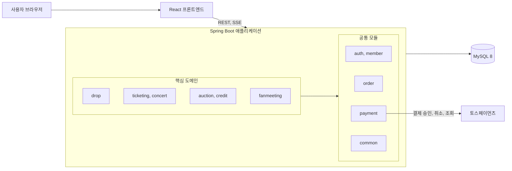

# NBE12-14-final-RESTLESS

팀 **쉬고 싶지 않음 청년**의 데브코스 최종 프로젝트. 아티스트와 팬을 연결하는 팬덤 이벤트 커머스 플랫폼이다.

한정판 드롭, 티켓팅, 경매, 팬미팅 추첨처럼 짧은 시간에 요청이 몰리는 거래를 다룬다.
기술 목표는 동시 요청 속에서도 재고, 좌석, 결제의 정합성을 지키고, 처리량과 지연시간을 측정하며 개선하는 것이다.
측정 방법은 [성능 실험 계획](docs/testing/performance.md)에 있다.

## 핵심 기능

| 도메인 | 해결하는 문제 | 핵심 방식 | 문서 |
|---|---|---|---|
| 한정판 드롭 | 구매자가 한꺼번에 몰려도 재고를 초과 판매하지 않는다 | 입장 제어로 동시 구매자 수를 제한하고, 재고를 예약한 뒤 결제가 승인되면 확정한다. 재고 행을 나눠 잠금 경합을 줄인다 | [drop](docs/domains/drop/README.md) |
| 티켓팅 | 한 좌석에 주인이 둘 생기지 않는다 | MySQL 행 잠금으로 좌석을 선점하고, 만료되면 전체 좌석을 반환한다. 티켓은 한 번만 발급한다 | [ticketing](docs/domains/ticketing/README.md) |
| 경매 | 종료 시점에 낙찰자는 많아야 한 명이다 | 입찰할 때 크레딧을 확보하고 이전 최고 입찰의 크레딧을 해제한다. 종료 직전 입찰은 종료 시각을 늘린다. 상태는 SSE로 전달한다 | [auction](docs/domains/auction/README.md) |
| 팬미팅 추첨 | 확정 인원과 결제 대기 인원의 합이 정원을 넘지 않는다 | 응모 후 재현 가능한 규칙으로 추첨한다. 결제 기한이 지나면 예비 당첨자를 승격한다 | [fanmeeting](docs/domains/fanmeeting/README.md) |

네 도메인은 회원, 인증, 주문, 결제 모듈을 함께 쓴다. 결제는 토스페이먼츠 테스트 환경에 연결했다.
PG 결과를 알 수 없을 때는 실패로 처리하지 않고, 미완료 결제 재확인 작업이 나중에 결과를 맞춘다.

## 아키텍처

배포 단위 하나 안에서 도메인마다 패키지와 데이터를 나누는 모듈러 모놀리스다.
다른 모듈의 저장소를 직접 쓰지 않고 그 모듈의 애플리케이션 서비스를 거친다. 이 경계는 ArchUnit 테스트가 검사한다.



배포는 GitHub Actions가 dev 커밋의 이미지를 GHCR에 올리고, EC2가 새 이미지를 받아 교체하는 방식이다. DB는 RDS MySQL을 쓴다.
자세한 내용은 [아키텍처 개요](docs/architecture/overview.md)와 [EC2 배포](deploy/ec2/README.md)에 있다.

## 기술 스택

| 구분 | 기술 |
|---|---|
| 백엔드 | Java 21, Spring Boot 4.1, Spring Data JPA, Flyway, Gradle |
| 데이터베이스 | MySQL 8 |
| 프론트엔드 | React, Vite, TypeScript |
| 결제 | 토스페이먼츠 테스트 환경 |
| 테스트 | JUnit, Testcontainers, ArchUnit, k6 |
| 인프라 | AWS EC2, RDS, Docker, GitHub Actions, GHCR |

## 실행 방법

```bash
cd backend && docker compose --profile dev up -d && ./gradlew bootRun   # MySQL과 백엔드
cd frontend && npm install && npm run dev                                # 프론트엔드, /api는 localhost:8080으로 프록시
cd backend && ./gradlew build                                            # 빌드와 전체 테스트, CI와 같음
```

환경 변수, 프로필, DB 초기화는 [CONTRIBUTING.md](CONTRIBUTING.md#로컬-실행)에 있다.

## 문서 지도

[docs/README.md](docs/README.md)에서 시작한다. 작업별로 읽을 문서가 정리돼 있다.

| 문서 | 내용 |
|---|---|
| [기획서](docs/product/proposal.md) | 서비스 의도, 사용자 시나리오, 범위, 일정 |
| [도메인 문서](docs/domains/) | 도메인별 정책, 불변식, 상태 머신, 트랜잭션 |
| [통합 ERD](docs/architecture/erd.md) | 도메인 사이 테이블 연결 |
| [API 계약](docs/contracts/api/README.md) | API 목록과 공통 규칙 |
| [ADR](docs/decisions/) | 이벤트 처리, 공통 규약, 결제 모듈 경계, 요청 횟수 제한, 드롭 재고 분할, 드롭 대기실 |
| [장애 처리](docs/operations/failure-handling.md) | PG 장애, 결과 불명확, 재시도 |
| [테스트 전략](docs/testing/strategy.md) | 테스트 종류와 실행 명령 |

## 디렉터리 구조

```text
.
├── AGENTS.md        # AI 코딩 에이전트 공통 규칙 (Codex, Claude Code)
├── CLAUDE.md        # Claude Code용, AGENTS.md를 불러옴
├── CONTRIBUTING.md  # 브랜치, PR, 커밋 규칙, 로컬 실행
├── backend/         # Spring Boot 애플리케이션, 모듈마다 api, application, domain, infrastructure
├── frontend/        # React, Vite, TypeScript
├── deploy/          # EC2 배포 스크립트
├── perf/            # 부하 테스트 시드 데이터와 k6 시나리오
└── docs/            # 설계 문서. 시작은 docs/README.md
```

## 팀원

| 이름 | GitHub | 핵심 도메인 | 공통 모듈과 그 밖의 역할 |
|---|---|---|---|
| 이태호 | [@anton061311](https://github.com/anton061311) | 한정판 드롭 | 주문, 결제, 배포와 CI/CD |
| 송혜민 | [@songfox00](https://github.com/songfox00) | 티켓팅 | 공연, 공연장 |
| 천종원 | [@vvipia](https://github.com/vvipia) | 경매 | 크레딧 |
| 홍승연 | [@GibGui](https://github.com/GibGui) | 팬미팅 추첨 | 인증, 회원 |
