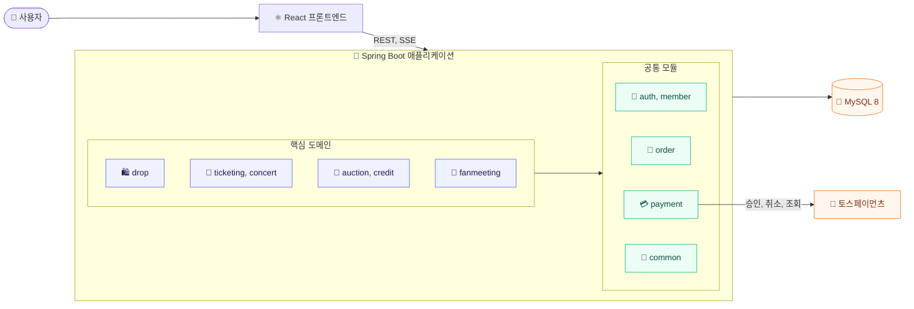
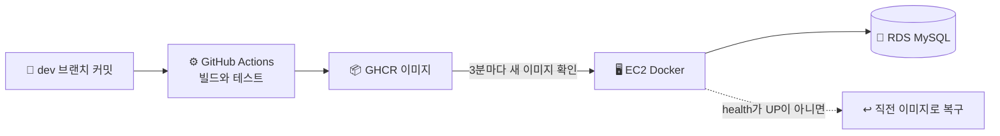

<div align="center">

# 🎤 FANQ

### 아티스트와 팬을 잇는 팬덤 이벤트 커머스 플랫폼

**FAN + QUEUE** | 티켓팅, 한정판 드롭, 실시간 경매, 팬미팅 추첨을 한 서비스에서

**팀 쉬고 싶지 않음 청년** | 프로그래머스 데브코스 백엔드 12기 14회차 최종 프로젝트

<br>


<br>


<br>

[🧭 핵심 기능](#-핵심-기능) &nbsp;|&nbsp; [🏗️ 아키텍처](#️-아키텍처) &nbsp;|&nbsp; [🚀 실행 방법](#-실행-방법) &nbsp;|&nbsp; [📚 문서 지도](#-문서-지도) &nbsp;|&nbsp; [👥 팀원](#-팀원)

</div>

<br>

> [!NOTE]
> 한정판 드롭, 티켓팅, 경매, 팬미팅 추첨처럼 **짧은 시간에 요청이 몰리는 거래**를 다룹니다.
> 기술 목표는 동시 요청 속에서도 **재고, 좌석, 결제의 정합성**을 지키고, **처리량과 지연시간을 측정하며 개선**하는 것입니다.
> 측정 방법은 [성능 실험 계획](docs/testing/performance.md)에 있습니다.

<br>

## 🧭 핵심 기능

<table>
<tr>
<td width="50%" valign="top">

### 🛍️ 한정판 드롭

> **재고를 절대 초과 판매하지 않는다**

- 입장 제어로 동시에 구매하는 인원을 제한합니다
- 재고를 먼저 예약하고, 결제가 승인되면 확정합니다
- 재고 행을 여러 개로 나눠 잠금 경합을 줄입니다

📄 [drop 문서](docs/domains/drop/README.md)

</td>
<td width="50%" valign="top">

### 🎫 티켓팅

> **한 좌석에 주인은 한 명뿐이다**

- MySQL 행 잠금으로 좌석을 선점합니다
- 선점이 만료되면 좌석을 모두 반환합니다
- 티켓은 한 번만 발급합니다

📄 [ticketing 문서](docs/domains/ticketing/README.md)

</td>
</tr>
<tr>
<td width="50%" valign="top">

### 🔨 경매

> **종료 시점의 낙찰자는 많아야 한 명이다**

- 입찰할 때 크레딧을 확보하고, 이전 최고 입찰의 크레딧은 해제합니다
- 종료 직전에 입찰이 들어오면 종료 시각을 늘립니다
- 경매 상태는 SSE로 실시간 전달합니다

📄 [auction 문서](docs/domains/auction/README.md)

</td>
<td width="50%" valign="top">

### 💌 팬미팅 추첨

> **확정 인원과 결제 대기 인원의 합이 정원을 넘지 않는다**

- 응모가 끝나면 재현 가능한 규칙으로 추첨합니다
- 결제 기한이 지나면 예비 당첨자를 승격합니다
- 정원이 모두 차면 모집을 끝냅니다

📄 [fanmeeting 문서](docs/domains/fanmeeting/README.md)

</td>
</tr>
</table>

### 💳 공통 결제

네 도메인은 회원, 인증, 주문, 결제 모듈을 함께 씁니다. 결제는 **토스페이먼츠 테스트 환경**에 연결했습니다.
PG 결과를 알 수 없으면 실패로 처리하지 않습니다. 대신 **미완료 결제 재확인 작업**이 나중에 결과를 맞춥니다.

<br>

## 🏗️ 아키텍처

배포 단위 하나 안에서 도메인마다 패키지와 데이터를 나누는 **모듈러 모놀리스**입니다.
다른 모듈의 저장소는 직접 쓰지 않고 그 모듈의 애플리케이션 서비스를 거칩니다. 이 경계는 **ArchUnit 테스트**가 검사합니다.



### ☁️ 배포



자세한 내용은 [아키텍처 개요](docs/architecture/overview.md)와 [EC2 배포](deploy/ec2/README.md)에 있습니다.

<br>

## 🛠️ 기술 스택

| 구분 | 기술 |
|---|---|
| 🍃 백엔드 | Java 21, Spring Boot 4.1, Spring Data JPA, Flyway, Gradle |
| 🐬 데이터베이스 | MySQL 8 |
| ⚛️ 프론트엔드 | React, Vite, TypeScript |
| 💳 결제 | 토스페이먼츠 테스트 환경 |
| 🧪 테스트 | JUnit, Testcontainers, ArchUnit, k6 |
| ☁️ 인프라 | AWS EC2, RDS, Docker, GitHub Actions, GHCR |

<br>

## 🚀 실행 방법

```bash
# 1. MySQL과 백엔드
cd backend && docker compose --profile dev up -d && ./gradlew bootRun

# 2. 프론트엔드, /api 요청은 localhost:8080으로 프록시
cd frontend && npm install && npm run dev

# 3. 빌드와 전체 테스트, CI와 같음
cd backend && ./gradlew build
```

> [!TIP]
> 환경 변수, 프로필, DB 초기화는 [CONTRIBUTING.md](CONTRIBUTING.md#로컬-실행)에 있습니다.

<br>

## 📚 문서 지도

[docs/README.md](docs/README.md)에서 시작합니다. 작업별로 읽을 문서가 정리돼 있습니다.

| | 문서 | 내용 |
|---|---|---|
| 📋 | [기획서](docs/product/proposal.md) | 서비스 의도, 사용자 시나리오, 범위, 일정 |
| 🧩 | [도메인 문서](docs/domains/) | 도메인별 정책, 불변식, 상태 머신, 트랜잭션 |
| 🗺️ | [통합 ERD](docs/architecture/erd.md) | 도메인 사이 테이블 연결 |
| 🔌 | [API 계약](docs/contracts/api/README.md) | API 목록과 공통 규칙 |
| 🧭 | [ADR](docs/decisions/) | 이벤트 처리, 공통 규약, 결제 모듈 경계, 요청 횟수 제한, 드롭 재고 분할, 드롭 대기실 |
| 🚨 | [장애 처리](docs/operations/failure-handling.md) | PG 장애, 결과 불명확, 재시도 |
| 🧪 | [테스트 전략](docs/testing/strategy.md) | 테스트 종류와 실행 명령 |

<details>
<summary>📁 디렉터리 구조</summary>

```text
.
├── AGENTS.md        # AI 코딩 에이전트 공통 규칙 (Codex, Claude Code)
├── CLAUDE.md        # Claude Code용, AGENTS.md를 불러옴
├── CONTRIBUTING.md  # 브랜치, PR, 커밋 규칙, 로컬 실행
├── backend/         # Spring Boot 애플리케이션, 모듈마다 api, application, domain, infrastructure
├── frontend/        # React, Vite, TypeScript
├── deploy/          # EC2 배포 스크립트
├── perf/            # 부하 테스트 시드 데이터와 k6 시나리오
└── docs/            # 설계 문서. 시작은 docs/README.md
```

</details>

<br>

## 👥 팀원

<table>
<tr>
<td align="center" width="25%">
<a href="https://github.com/anton061311"><br><b>이태호</b></a><br>
<sub>@anton061311</sub><br><br>
🛍️ <b>한정판 드롭</b><br>
<sub>주문, 결제, 배포와 CI/CD</sub>
</td>
<td align="center" width="25%">
<a href="https://github.com/songfox00"><br><b>송혜민</b></a><br>
<sub>@songfox00</sub><br><br>
🎫 <b>티켓팅</b><br>
<sub>공연, 공연장</sub>
</td>
<td align="center" width="25%">
<a href="https://github.com/vvipia"><br><b>천종원</b></a><br>
<sub>@vvipia</sub><br><br>
🔨 <b>경매</b><br>
<sub>크레딧</sub>
</td>
<td align="center" width="25%">
<a href="https://github.com/GibGui"><br><b>홍승연</b></a><br>
<sub>@GibGui</sub><br><br>
💌 <b>팬미팅 추첨</b><br>
<sub>인증, 회원</sub>
</td>
</tr>
</table>
