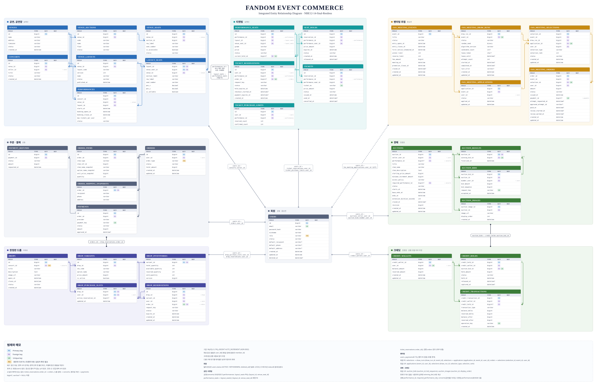
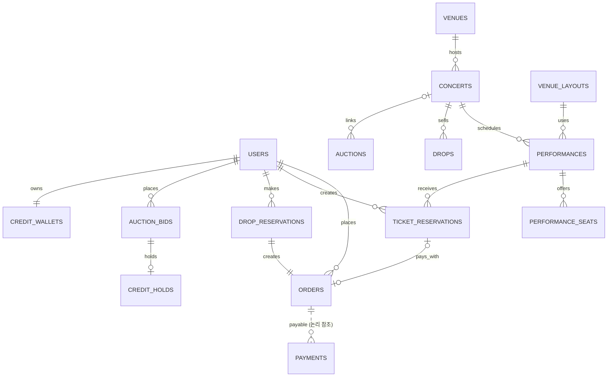

# 통합 ERD

- 상태: Draft (2026-11-11)
- 기준: MySQL 8, PK는 `BIGINT AUTO_INCREMENT`, 시각은 `DATETIME(6)` UTC ([ADR-0002](../decisions/0002-common-conventions.md))
- 컬럼 정본은 아래 그림이다. 실제 DDL은 `backend/src/main/resources/db/migration/`에 있다.
- 주문·결제·드롭 테이블은 그림 작성 뒤 마이그레이션으로 바뀌었다(결제의 `order_id` 제거, `payable_type`/`payable_id`/`idempotency_key` 등 추가, 드롭 대기열 추가). 이 테이블들은 마이그레이션이 정본이다.

표기:

- `bigint?`, `varchar?`는 NULL 허용이다.
- `확인` 표시는 원본과 다르거나 취합자가 추론한 부분이다. 담당자 확인이 필요하다.
- 실선은 물리 FK, 점선은 물리 FK 없는 논리 참조다.

## 1. 영역과 담당

| 영역 | 담당 | 테이블 |
|---|---|---|
| 회원 | 공통 (홍승연) | `users` |
| 주문·결제 | 공통 | `orders`, `order_items`, `order_shipping_snapshots`, `payments`, `payment_refunds` |
| 공연, 공연장 | 송혜민 | `venues`, `venue_sections`, `venue_seats`, `venue_layouts`, `layout_seats`, `concerts`, `performances` |
| 티켓팅 | 송혜민 | `performance_seats`, `seat_holds`, `ticket_reservations`, `tickets`, `ticket_purchase_limits` |
| 한정판 드롭 | 이태호 | `drops`, `drop_variants`, `drop_inventories`, `drop_reservations`, `drop_purchase_slots`, `drop_queue_entries` |
| 팬미팅 추첨 | 홍승연 | `fan_meeting_events`, `fan_meeting_draw_runs`, `fan_meeting_applications`, `fan_meeting_selections`, `fan_meeting_orders` |
| 경매 | 천종원 | `auctions`, `auction_bids`, `auction_results`, `auction_images` |
| 크레딧 | 천종원 (공통 모듈 여부 미정) | `credit_wallets`, `credit_holds`, `credit_transactions` |

## 2. 도메인 사이 연결

- 회원 참조 컬럼 이름은 `user_id`로 통일한다 (경매 원본은 `member_id`).
- 공연(`concerts`)은 티켓팅, 드롭, 경매가 함께 참조한다.
- 경매의 `performance_id`, `required_performance_id`는 `concerts`(공연)를 가리킨다. 티켓팅의 `performances`(회차)와 다르다.
- 팬미팅은 `users`, `payments`로 가는 물리 FK가 없다 (모듈 경계). `user_id`, `payment_id`는 논리 참조다.

## 3. 영역별 규칙

### 회원

- 탈퇴 판단은 `users.status`(ACTIVE, WITHDRAWN)로 한다. `deleted_at`은 탈퇴 시각이며 CHECK로 status와 함께 맞춘다.

### 공연, 티켓팅

- 공연(`concerts`) 아래 회차가 `performances`다.
- 공연·회차·배치·좌석의 공연장 소속과 회차별 판매 좌석의 정확한 배치 일치는 [복합 FK 계약](../domains/ticketing/venue-consistency.md)을 따른다. V20261112_1020 마이그레이션에 정의한다.
- `layout_seats`의 PK는 `(layout_id, venue_seat_id)`다. `performance_seats`는 이 복합 키를 FK로 참조한다.
- 현재 소유권은 `performance_seats.status`와 `current_hold_id`로 판단한다. 모든 소유권 변경은 좌석 행 잠금 아래 수행한다.
- `UNIQUE(current_hold_id)`는 같은 선점을 여러 좌석의 현재 소유자로 연결하지 못하게 한다. 이것만으로 좌석별 HELD 이력 중복을 막지는 않는다.
- 상태·포인터 CHECK와 소유 좌석 일치 복합 FK, 예약·선점·티켓의 회차 일치는 V20261112_1020에 정의한다 ([관계 정합성](../domains/ticketing/reservation-seat-consistency.md)). [확정 설계와 구현 차이](../domains/ticketing/seat-ownership.md)를 참고한다.
- `performance_seats.current_hold_id`와 `seat_holds.performance_seat_id`는 서로를 참조한다. 마이그레이션에서는 두 테이블을 만든 뒤 `current_hold_id` FK를 마지막에 건다.
- `ticket_reservations.order_id`는 공통 `orders`를 참조한다.
- `tickets.ticket_no`는 UUID v4 문자열이며 UNIQUE다. 내부 PK는 BIGINT를 유지한다. 동일 예약·좌석의 중복 발급은 UNIQUE(reservation_id, performance_seat_id)로 막는다. [발급 설계](../domains/ticketing/ticket-issuance.md)에 따라 V20261112_1020 마이그레이션으로 추가한다.

### 드롭

- 구매 대기열은 `drop_queue_entries`다 (V20261113_1800, [data-model.md](../domains/drop/data-model.md)). 그림에는 아직 없다.
- `drops.concert_id`는 현재 필수(NOT NULL FK)로 구현돼 있다. NULL 허용 여부는 팀 확인 대상으로 남아 있다.
- 결제는 주문을 FK로 가리키지 않는다. `payments.payable_type`/`payable_id`로 결제 대상(드롭은 재고 점유 ID)을 가리킨다 ([ADR-0003](../decisions/0003-payment-module-boundary.md)).

### 팬미팅

- 복합 FK로 같은 이벤트, 같은 사용자끼리만 연결한다.
  - `selections` → `draw_runs` `(draw_run_id, event_id)`
  - `selections` → `applications` `(application_id, event_id, user_id)`
  - `orders` → `selections` `(selection_id, event_id, user_id)`
- 묶음 UK: `applications (event_id, user_id)`, `selections (draw_run_id, selection_type, selection_rank)`
- 이벤트당 추첨 실행은 최대 1건이다: `draw_runs.event_id` UNIQUE.

### 경매, 크레딧

- 묶음 UK: `auction_bids (auction_id, bid_sequence)`, `auction_images (auction_id, display_order)`
- 현재가 캐시는 두지 않는다. 낙찰자와 금액은 `auction_results.winning_bid_id`로 계산한다.
- 입찰 하나에 묶이는 크레딧은 최대 1건이다: `credit_holds.auction_bid_id` UNIQUE.

## 4. 도메인 사이 확인할 것

| 항목 | 관련 |
|---|---|
| `users.role` 이름 (문서마다 USER, FAN, SELLER, ORGANIZER, ADMIN이 다름) | 전체 |
| ~~`orders.order_type`의 티켓팅 값~~ 결정: `DROP`, `TICKET` (`ck_orders_order_type`, `V20261112_2100`). 상태도 `ck_orders_status`로 제한 | 티켓팅, 공통 결제 |
| ~~`payments.payment_key`가 NOT NULL인데, 승인 전(READY)에도 값이 있는지~~ 결정: NULL 허용, 승인 시작 때 채움 ([ADR-0003](../decisions/0003-payment-module-boundary.md)) | 공통 결제 |
| ~~`auction_results.winning_bid_id`가 NOT NULL인데, 유찰을 결과 행으로 남기는지~~ 결정: 미낙찰도 결과 행으로 남김. `result_type`(`SOLD`/`UNSOLD`) 추가, `winning_bid_id` NULL 허용 (`V20261112_1045`) | 경매 |
| 경매 입장 자격(`access_policy`, `required_performance_id`)을 티켓팅의 어떤 상태로 판단하는지 | 경매, 티켓팅 |
| 크레딧을 공통 모듈로 둘지 경매가 소유할지, 드롭 구매에도 쓰는지 | 경매, 드롭, 공통 |
| ~~팬미팅 결제(`fan_meeting_orders.payment_id`)를 공통 `payments`와 어떻게 연결하는지~~ 결정: `payments.(payable_type, payable_id)`로 연결, 물리 FK 없음 ([ADR-0003](../decisions/0003-payment-module-boundary.md)) | 팬미팅, 공통 결제 |
| 공연 취소 시 연결된 드롭, 경매 처리 | 전체 |
