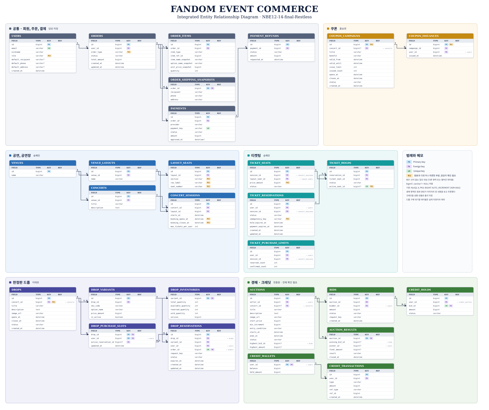
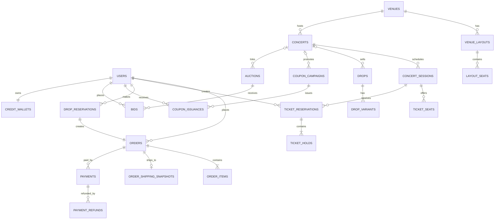
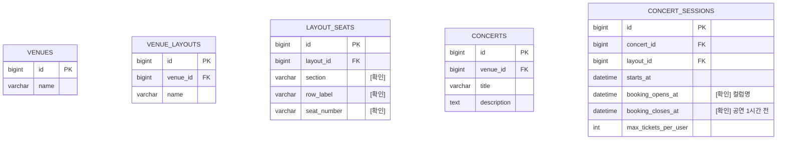
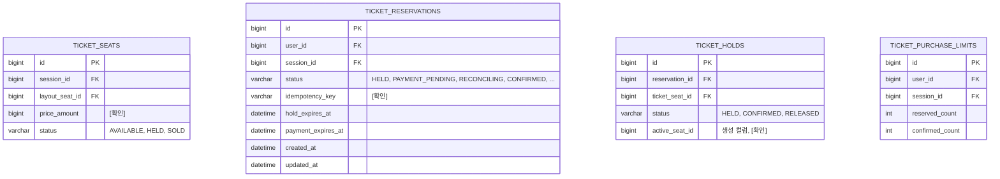
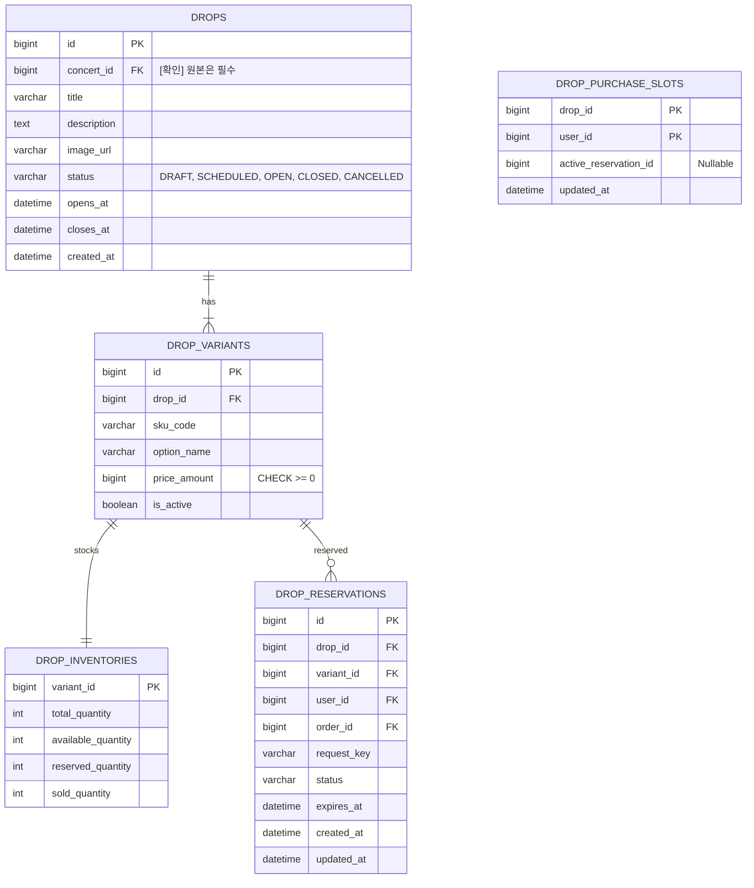
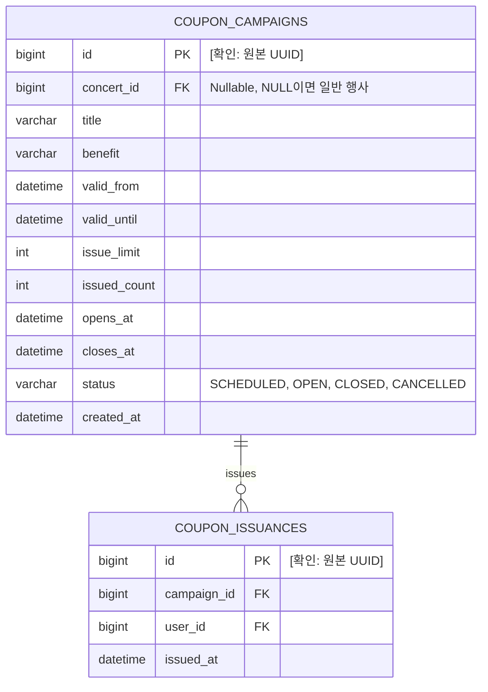
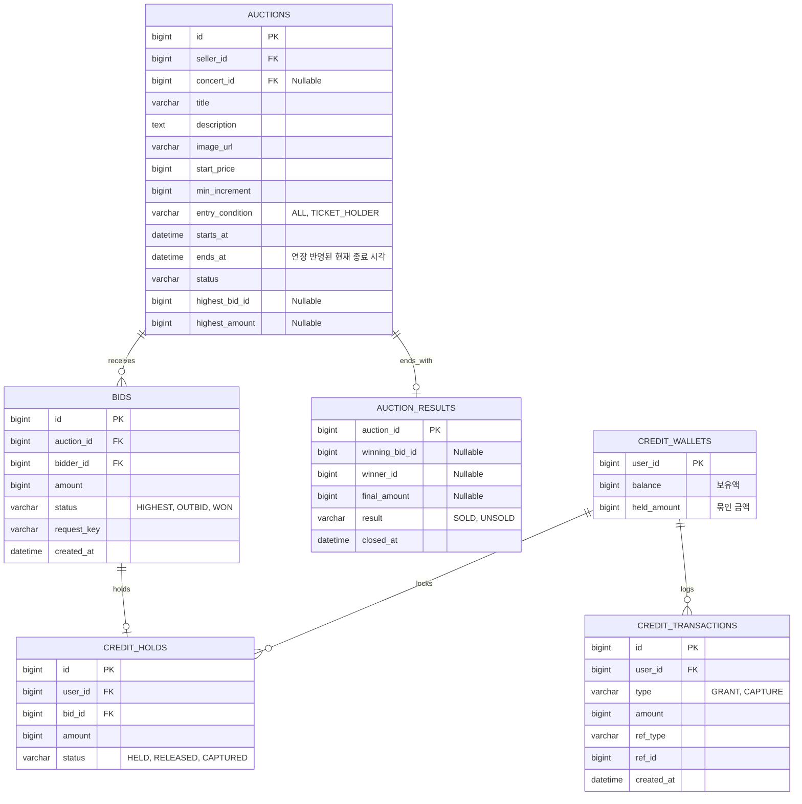

# 통합 ERD

- 상태: Draft (2026-11-10, 이태호 취합)
- 기준: MySQL 8, PK는 `BIGINT AUTO_INCREMENT` ([ADR-0002](../decisions/0002-common-conventions.md))
- 각 도메인의 정본은 담당자 문서다. 이 문서는 도메인 사이 연결을 한눈에 보기 위한 취합본이다.

표기:

- `[확인]` 원본 문서와 다르게 바꿨거나 원본에 없어 취합자가 추론한 부분. 담당자 확인이 필요하다.
- 시각 컬럼은 `DATETIME(6)`이며 UTC로 저장한다.

## 1. 전체 관계

공연(`CONCERTS`)은 티켓팅, 드롭, 쿠폰, 경매가 함께 참조한다. 쿠폰과 경매의 `concert_id`는 원본에서 Nullable이다(공연 없이도 운영). 드롭은 원본이 필수라서 `[확인]`이다.

## 2. 공통 (담당 TBD)

```mermaid
erDiagram
    USERS {
        bigint id PK
        varchar email UK
        varchar nickname
        varchar role "USER, ORGANIZER, ADMIN [확인]"
        varchar default_recipient "Nullable"
        varchar default_phone "Nullable"
        varchar default_address "Nullable"
        datetime created_at
    }
    ORDERS {
        bigint id PK
        bigint user_id FK
        varchar order_type "DROP [확인: 티켓팅 사용 여부]"
        varchar status "PENDING_PAYMENT, PAID, ..."
        bigint total_amount
        datetime created_at
        datetime updated_at
    }
    ORDER_ITEMS {
        bigint id PK
        bigint order_id FK
        varchar item_type "DROP_VARIANT 등"
        bigint item_ref_id
        varchar item_name_snapshot
        varchar option_name_snapshot
        bigint unit_price_snapshot
        int quantity
    }
    ORDER_SHIPPING_SNAPSHOTS {
        bigint order_id PK
        varchar recipient
        varchar phone
        varchar address
    }
    PAYMENTS {
        bigint id PK
        bigint order_id FK
        varchar provider "TOSS"
        varchar payment_key UK "PG 결제 키"
        varchar status "READY, PROCESSING, APPROVED, FAILED, UNKNOWN, ..."
        bigint amount
        datetime approved_at
    }
    PAYMENT_REFUNDS {
        bigint id PK
        bigint payment_id FK
        varchar status "CANCEL_PENDING, CANCELLED, CANCEL_UNKNOWN"
        bigint amount
        datetime requested_at
    }
```

회원 필드, 역할, 결제 테이블은 담당이 정해지지 않았다. 드롭의 요구사항을 기준으로 적은 초안이다.

## 3. 공연, 공연장 (티켓팅, 송혜민)

## 4. 티켓팅 (송혜민)

제약: `UNIQUE(session_id, layout_seat_id)`, `UNIQUE(user_id, session_id)`, `CHECK(reserved_count >= 0 AND confirmed_count >= 0)`

## 5. 드롭 (이태호)

대기열 테이블은 아직 미정이다([data-model.md](../domains/drop/data-model.md)).

## 6. 쿠폰 (홍승연)

제약: `CHECK(issue_limit > 0 AND issued_count BETWEEN 0 AND issue_limit)`, `CHECK(closes_at > opens_at)`, `UNIQUE(campaign_id, user_id)`, `INDEX(user_id, issued_at)`

## 7. 경매 (천종원)

원본 문서의 ERD가 Notion 이미지라서 내용을 확인하지 못했다. 아래는 원본의 "도메인 구조 설계안" 표를 보고 취합자가 만든 초안이며 전부 `[확인]` 대상이다.

크레딧(`CREDIT_*`) 테이블은 경매 원본에서 "공통 기능 담당자와 사용 규칙 합의"로 되어 있다. 공통 모듈로 뺄지, 경매가 소유할지 미정이라 일단 경매 절에 두었다.

제약 후보: `UNIQUE(bid_id)` on CREDIT_HOLDS, `CHECK(balance >= held_amount AND held_amount >= 0)`, `UNIQUE(auction_id, bidder_id, request_key)` on BIDS

## 8. MySQL로 옮기면서 바뀌는 부분

티켓팅과 쿠폰 원본은 PostgreSQL 기준이다. 팀 결정(MySQL)에 맞추려면 아래를 바꿔야 한다. 담당자가 확인한다.

| 원본 (PostgreSQL) | MySQL 대안 | 해당 도메인 |
|---|---|---|
| `CREATE UNIQUE INDEX ... WHERE status = 'HELD'` (부분 인덱스) | 생성 컬럼 `active_seat_id = IF(status = 'HELD', ticket_seat_id, NULL)`에 UNIQUE. NULL은 중복 허용이라 HELD일 때만 막힌다 | 티켓팅 |
| `INSERT ... ON CONFLICT DO NOTHING` | `INSERT IGNORE` 또는 UNIQUE 위반 예외 처리. `INSERT IGNORE`는 다른 오류도 경고로 바꾸므로 주의 | 쿠폰 |
| UUID PK | `BIGINT AUTO_INCREMENT` | 쿠폰 |
| `TIMESTAMPTZ` | `DATETIME(6)` + UTC 저장 | 쿠폰 |
| "예외 대신 영향 행 수로 판단해 트랜잭션 중단을 피한다" | MySQL은 오류 후에도 트랜잭션이 중단되지 않는다. 영향 행 수 판단은 그대로 써도 된다 | 쿠폰 |

CHECK 제약은 MySQL 8.0.16부터 실제로 검사된다.

## 9. 도메인 사이 확인할 것

| 항목 | 관련 |
|---|---|
| 티켓팅 결제가 공통 `ORDERS`를 쓰는지, 예약에서 바로 `PAYMENTS`로 가는지 | 티켓팅, 공통 결제 |
| 경매 크레딧 지갑을 드롭 구매에도 쓰는지 (현재 드롭은 PG 결제만) | 경매, 드롭 |
| 경매 입장 자격(티켓 소유)을 티켓팅의 어떤 상태로 판단하는지 | 경매, 티켓팅 |
| 공연 취소 시 연결된 드롭, 쿠폰, 경매 처리 | 전체 |
| 회원 역할 이름 (USER, FAN, SELLER, ORGANIZER, ADMIN이 문서마다 다름) | 전체 |
| 공통 결제 연동 방식: 티켓팅은 결제 결과 이벤트(PaymentSucceeded 등)를 받고, 드롭은 승인 API를 동기 호출한다 | 티켓팅, 드롭, 공통 결제 |
| 크레딧을 공통 모듈로 둘지 경매가 소유할지 | 경매, 공통 |
| 쿠폰의 Outbox 전제(coupon.issued)를 ADR-0001(Spring Event)에 맞출지 | 쿠폰 |
