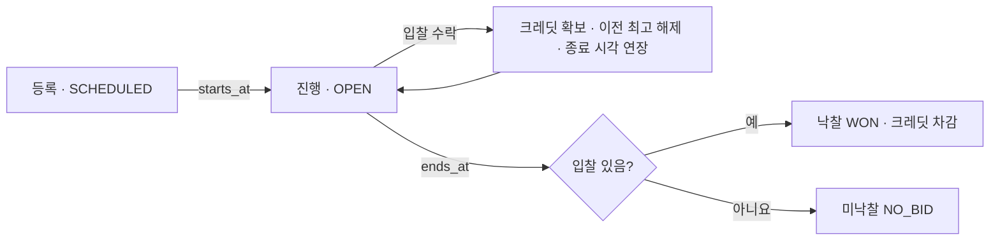

# Auction 도메인

담당자: 천종원

| 문서 | 내용 |
|---|---|
| [policy.md](policy.md) | 1차 범위, 권한, 등록·입찰·연장·크레딧·실시간 정책 |
| [invariants.md](invariants.md) | INV-AU-01 ~ 15, 테스트용 확인 SQL, 스키마 보강 항목 |
| [state-machines.md](state-machines.md) | 경매, 입찰(계산), 결과, 크레딧 확보·내역 상태 |
| [transactions.md](transactions.md) | 크레딧 지급, 입찰, 시작, 종료, 수정·삭제 트랜잭션과 장애 시나리오 |
| [design.md](design.md) | 담당자 설계 원본 (Notion에서 옮김) |
| [API 계약](../../contracts/api/auction.md) | 1차 API, 오류 코드, SSE 스트림 |
| [통합 ERD](../../architecture/erd.md) | 도메인 사이 연결 |

## 한 줄 요약

주최자가 경매를 등록하면, 회원은 크레딧을 확보한 채 더 높은 금액으로 입찰한다. 종료 직전 입찰은 종료 시각을 늘리고, 종료 시점의 최고 입찰자가 자기 금액으로 낙찰받아 크레딧이 차감된다.

## 테이블

| 테이블 | 역할 |
|---|---|
| `auctions` | 판매자, 물품, 가격 조건, 일정, 상태, `revision`. 입찰과 종료의 잠금 기준 행 |
| `auction_bids` | 수락된 입찰 전체. `bid_sequence`가 가장 큰 입찰이 현재 최고 입찰 |
| `auction_results` | 경매당 결과 하나 (`WON` / `NO_BID`) |
| `credit_wallets` | 회원당 지갑 하나. 보유액, 묶인 금액 |
| `credit_holds` | 입찰 하나에 묶인 크레딧 (`HELD` / `RELEASED` / `CAPTURED`) |
| `credit_transactions` | 크레딧 변동 내역 |
| `auction_images` | 1차에서 쓰지 않음 |

컬럼은 [통합 ERD](../../architecture/erd.md)와 `V20261111_1030`, `V20261111_1040` 마이그레이션에 있다. 1차 구현 전에 보강할 제약은 [invariants.md](invariants.md) 마지막 절에 있다.

design.md는 받은 그대로 두었다. policy, invariants, state-machines, transactions와 API 계약은 담당자(천종원)가 결정한 1차 구현 기준이다. 원본과 다르면 이 문서들을 따른다. 상태는 PROPOSED이며, 다른 도메인과 맞닿는 부분(권한 경로, 회원 닉네임 조회)은 해당 담당자 리뷰 후 확정한다.
