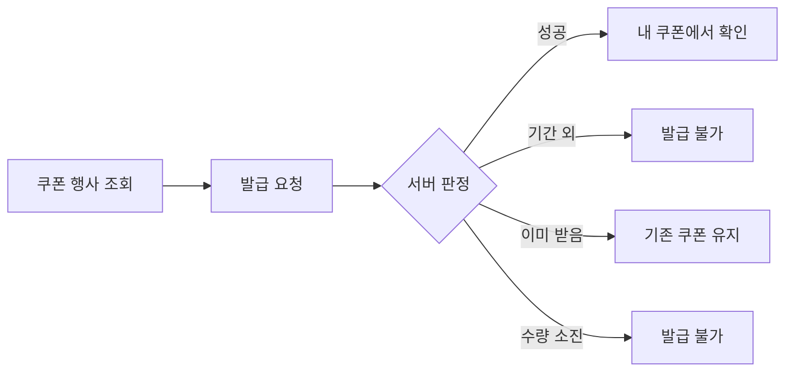
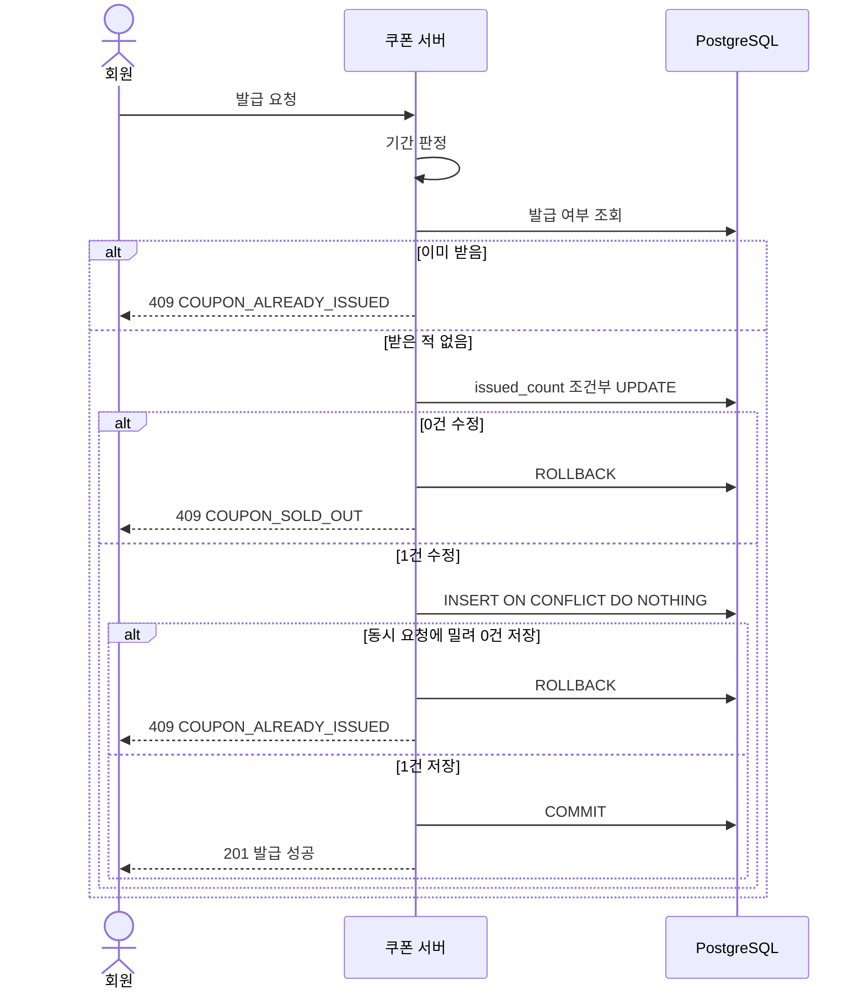
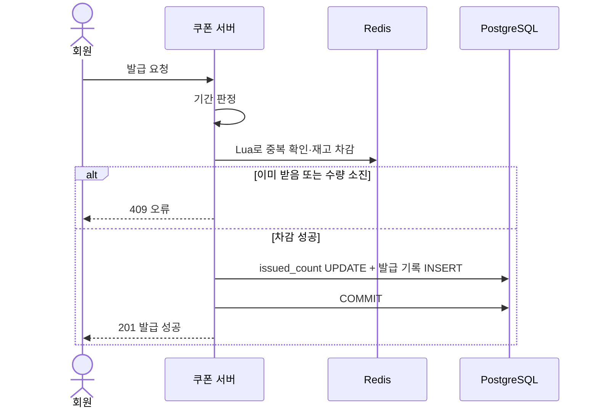
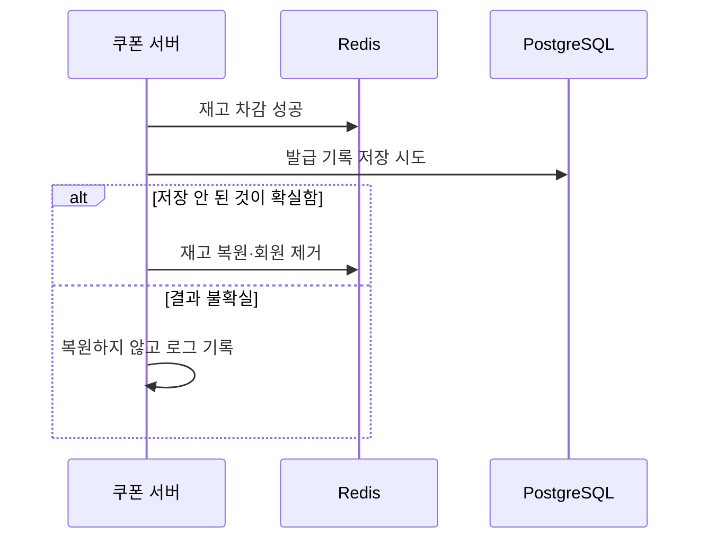
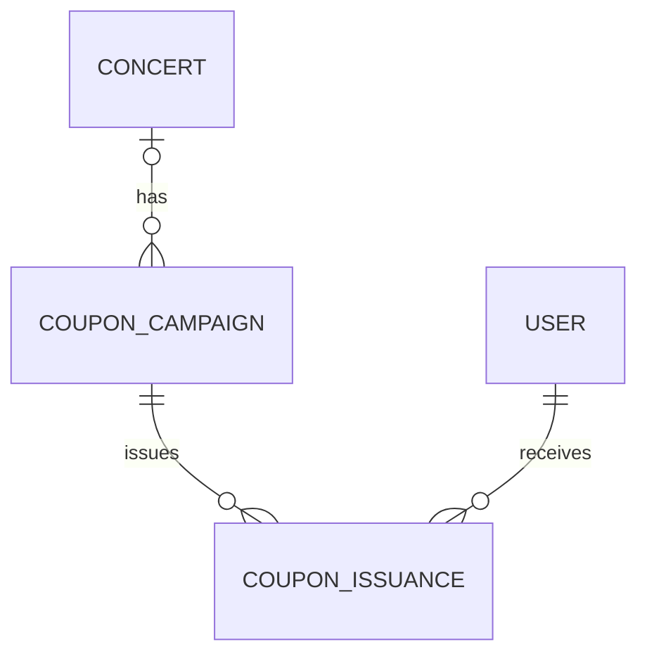
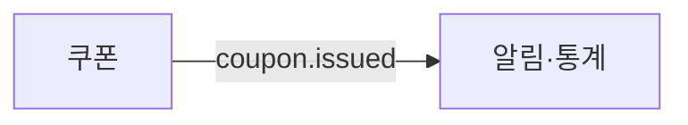

## [3] MVP 범위 및 핵심 사용자 시나리오

### 개발 목표

쿠폰 행사를 조회하고, 정해진 시각에 발급을 요청해 한정 수량의 쿠폰을 먼저 받는 서비스를 구현한다.

**핵심 목표:** 요청이 한 행사에 몰려도 초과 발급과 1인 중복 발급을 막고, 대량 요청을 처리하는 방법을 비교·검증한다.

### 사용자 발급 흐름



**P0 · 필수**

행사 등록·수정·취소, 행사 조회, 선착순 발급, 1인 1장, 내 쿠폰 조회, 동시성 제어

**P1 · 확장**

소진 후 조기 거절, Redis 재고 판정, 처리 방식 성능 비교, Redis–DB 실패 복구, `coupon.issued` 발행

MVP에서는 **발급과 조회까지만 지원**하며, 주문 할인 적용·환원·재발급·추첨·대기열·티켓 보유자 한정은 제외한다.

## [4] 기능 및 요구사항

| 핵심 기능 | 요구사항 |
| --- | --- |
| 행사 등록 | 공연 행사 또는 일반 행사로 등록, 시작 전 수정·취소 |
| 행사 조회 | 남은 수량, 시작까지 남은 시간, 내 발급 여부 표시 |
| 선착순 발급 | 기간 → 중복 → 수량 순서로 판정 |
| 발급 제한 | 행사별 1인 1장 |
| 내 쿠폰 조회 | 본인 쿠폰만 최신순 조회 |
| 상태 변경 | 스케줄러 + 요청 시 시각 검증 |
| 운영 조회 | 한도, 발급 수, 상태 조회 |

### 비기능 요구사항

| 항목 | 목표·지표 |
| --- | --- |
| 초과 발급·1인 중복 발급 | 0건 |
| 성공 응답한 쿠폰의 기록 누락 | 0건 |
| 성능 측정 지표 | p95/p99, RPS, 오류율, 연결 대기, 잠금 대기 |

### 시스템 불변식

어떤 동시 요청 상황에서도 반드시 지켜야 하는 조건

**발급 수량 ≤ 발급 한도**

동시 요청이 몰려도 초과 발급 금지

---

**행사 + 회원 = 쿠폰 최대 1장**

같은 회원의 동시 요청도 1장만 발급

---

**성공 응답 = 발급 기록 존재**

DB 커밋 후에만 성공 응답

## [6] 상태 머신

### 쿠폰 행사 상태 변화



**수량 증가와 발급 기록은 한 트랜잭션**으로 처리하고, 커밋 후에만 성공으로 응답한다.

### 7.2 선착순 발급 (Redis 방식, P1)



Redis는 빠른 판정용 사본이다. Redis 재고가 어긋나도 DB 조건이 초과 발급을 막는다.

### 7.3 Redis 차감 후 DB 저장 실패 (P1)



재고를 복원하지 않으면 덜 발급될 수는 있어도 초과 발급은 일어나지 않는다.

## [8] ERD, API, 이벤트 계약

### 8.1 핵심 ERD



**핵심 설계:** 행사 구분 컬럼 없이 `concert_id` 유무로 공연 행사와 일반 행사를 구분하고, 발급 기록으로 쿠폰 보유를 판단한다.

DB에서는 조건부 UPDATE와 UNIQUE 제약조건을 함께 사용해 초과 발급과 중복 발급을 방지한다.

### 8.2 주요 API

회원 식별 값은 요청 본문이 아니라 서버가 검증한 인증 정보에서 가져온다. 재시도는 `UNIQUE (campaign_id, user_id)`로 보호하므로 `Idempotency-Key`를 쓰지 않는다.

### 8.3 이벤트 계약



## 기술적 도전 과제

**1. 동시성 제어**

한 행에 요청이 몰리는 상황에서 조건부 UPDATE로 초과 발급을 막고, UNIQUE 제약조건으로 1인 중복 발급을 막는다.

---

**2. 처리 방식 비교 (P1)**

DB 조건부 UPDATE, 소진 후 조기 거절, Redis Lua를 같은 조건에서 비교한다. 로컬 사전 실험에서는 재고가 남은 구간의 처리량이 세 방식 모두 비슷해, 발급마다 갱신하는 `issued_count` 행이 병목으로 추정된다. 원인 검증과 EC2 측정은 구현 후에 진행한다.

---

**3. 장애 복구 (P1)**

Redis 차감 후 DB 저장 실패, 앱 강제 종료, Redis 유실 상황을 재현하고 최종 수량을 대조한다.

---

**4. 성능 검증**

k6로 목표 RPS를 단계적으로 올리며 p95/p99, RPS, 오류율, Hikari 대기, 잠금 대기를 측정한다. 품절·중복 같은 정상 거절은 실패로 세지 않는다.

- 상세
  ## [3] MVP 범위 및 핵심 사용자 시나리오
  ### 3.1 개발 목표

  운영자가 수량과 기간을 정해 쿠폰 행사를 등록하고, 회원이 시작 시각에 발급을 요청해 쿠폰을 받을 수 있는 서비스를 구현한다.

  핵심 기술 목표는 동시 요청 상황에서 초과 발급과 1인 중복 발급을 방지하고, DB 방식과 Redis 방식의 효과를 정량적으로 비교하는 것이다.
  ### 3.2 MVP 범위
  
  | 구분       | 기능                                     | 우선순위 |
  | -------- | -------------------------------------- | ---- |
  | 행사 등록    | 공연 행사·일반 행사 등록                         | P0   |
  | 행사 관리    | 시작 전 수정·취소, 운영 정보 조회                   | P0   |
  | 행사 조회    | 목록·상세, 남은 수량, 내 발급 여부                  | P0   |
  | 선착순 발급   | 기간·중복·수량 판정 후 발급                       | P0   |
  | 내 쿠폰     | 본인 쿠폰 조회                               | P0   |
  | 상태 변경    | 스케줄러 및 요청 시 시각 검증                      | P0   |
  | 동시성 검증   | 조건부 UPDATE, UNIQUE, Testcontainers 테스트 | P0   |
  | 조기 거절    | 소진 후 잠금 전 거절                           | P1   |
  | Redis 판정 | Lua 재고 차감 + 중복 확인                      | P1   |
  | 복구       | Redis–DB 실패 처리, Redis 유실 시 재구축         | P1   |
  | 성능 비교    | 세 가지 처리 방식 비교                          | P1   |
  | 이벤트      | `coupon.issued` 발행                     | P1   |
  

  MVP 제외 범위: 주문 할인 적용, 환원·재발급, 발급된 쿠폰 취소·회수, 추첨, 대기열, 1인 복수 발급, 티켓 보유자 한정, 임시저장 기능, 키워드 검색.
  ### 3.3 핵심 사용자 시나리오
  1. 행사 등록
  
     운영자가 공연 행사 또는 일반 행사를 선택하고 제목, 혜택, 유효기간, 발급 한도, 시작·종료 시각을 등록한다.
  2. 행사 조회
  
     회원이 공연 상세나 쿠폰 행사 목록에서 행사에 들어가 남은 수량과 시작까지 남은 시간을 확인한다.
  3. 발급 요청
  
     시작 시각 이후 발급을 요청하면 서버가 기간, 중복, 수량 순서로 판정한다.
  4. 발급 결과 확인
  
     성공하면 내 쿠폰에서 확인한다. 실패하면 이미 받음, 수량 소진, 시작 전, 기간 종료 중 하나를 안내받는다.
  5. 행사 수정·취소
  
     운영자는 시작 전에 잘못 등록한 행사를 고치거나 내릴 수 있다. 시작 전에는 발급된 쿠폰이 없으므로 받은 쿠폰에 영향이 없다.
  ## [4] 기능 정의 및 요구사항 정의
  ### 4.1 기능 요구사항
  
  | ID                | 기능       | 요구사항                                                |
  | ----------------- | -------- | --------------------------------------------------- |
  | FR-COUPON-01      | 행사 등록    | 행사 구분, 제목, 혜택, 유효기간, 한도, 기간을 등록. 공연 행사인데 공연이 없으면 거부 |
  | FR-COUPON-01      | 행사 수정·취소 | 시작 전만 허용, 시작 후 한도·시각 수정 거부                          |
  | FR-COUPON-02      | 선착순 발급   | 기간 → 중복 → 수량 순서로 판정하고 한도 내 발급                       |
  | FR-COUPON-03      | 내 쿠폰 조회  | 본인 쿠폰을 최신순으로 조회                                     |
  | FR-COUPON-04 (제안) | 행사 조회    | 공연·일반 행사 목록과 상세 제공. `DRAFT`, `CANCELLED`는 노출 안 함    |
  | FR-CONTENT-02     | 공연 연동    | 공연 번호로 행사 식별자와 상태를 찾는 창구 제공                         |
  | FR-ADMIN-01       | 운영 조회    | 한도, 발급 수, 상태 조회                                     |
  | FR-MESSAGE-01     | 이벤트 전달   | Outbox 완성 후 `coupon.issued` 기록 (P1)                 |
  
  ### 4.2 비기능 요구사항
  
  | ID     | 항목  | 요구사항                                |
  | ------ | --- | ----------------------------------- |
  | NFR-01 | 정합성 | 초과 발급 및 1인 중복 발급 0건                 |
  | NFR-02 | 멱등성 | 같은 회원의 재요청으로 쿠폰이 늘어나지 않음            |
  | NFR-03 | 보안  | 본인 쿠폰만 조회, 운영자 API는 ADMIN만 호출       |
  | NFR-04 | 성능  | p95, p99, RPS, 오류율, 연결 대기, 잠금 대기 측정 |
  | NFR-05 | 복구  | Redis–DB 실패와 앱 재시작 후 수량 대조          |
  | NFR-06 | 확장성 | 단일·다중 인스턴스 비교                       |
  

  측정 조건을 맞추기 위해 Hikari `connection-timeout`은 3초로 고정한다.
  ## [5] 비즈니스 정책 및 불변식
  ### 5.1 비즈니스 정책
  
  | 영역       | 정책                                      |
  | -------- | --------------------------------------- |
  | 대상       | 로그인 회원 전체                               |
  | 발급 제한    | 행사별 1인 1장                               |
  | 발급 기간    | `[opens_at, closes_at)`                 |
  | 시각 기준    | 서버 수신 시각                                |
  | 판정 순서    | 기간 → 이미 발급 → 수량 소진                      |
  | 행사 구분    | `concert_id`가 있으면 공연 행사, `NULL`이면 일반 행사 |
  | 아티스트 연결  | 컬럼 없이 공연을 통해 조회                         |
  | 등록       | 등록 즉시 `SCHEDULED`로 공개                   |
  | 수정·취소    | 시작 전만 허용                                |
  | 품절 표시    | 남은 수량으로 계산, 표시 지연 허용                    |
  | 쿠폰 만료    | 유효기간 경과 시 조회에서 만료로 표시                   |
  | 상태 변경    | 스케줄러는 보조, 발급 가능 여부는 API가 시각으로 직접 판정     |
  | 발급 기준    | PostgreSQL이 최종 기준, Redis는 판정용 사본        |
  | 재고 복원    | 저장 안 된 것이 확실할 때만 복원                     |
  | Redis 장애 | 503 응답, 유실 시 발급 기록 기준으로 재구축 후 재개        |
  
  ### 5.2 시스템 불변식

  다음 조건은 어떠한 동시 요청 상황에서도 반드시 지켜져야 한다.

  **INV-CP-01. 총발급량 제한**
  - 유효 발급 수량은 발급 한도를 초과할 수 없다.
  - `유효 발급 수량 ≤ 쿠폰 총발급 한도`

  **INV-CP-02. 사용자별 중복 발급 방지**
  - 동일 회원은 같은 행사에서 쿠폰을 최대 1장만 가진다.
  - `동일 캠페인 + 동일 사용자 → 유효 쿠폰 최대 1개`

  **INV-CP-03. 발급 결과의 영속성**
  - 발급 성공을 응답했다면 발급 기록으로 확인할 수 있어야 한다.
  - DB 커밋 후에만 성공으로 응답한다.

  **보조 조건. 발급 수와 발급 기록의 일치**
  - `issued_count`는 실제 발급 기록 수와 같아야 한다.
  - 두 값은 하나의 DB 트랜잭션에서 함께 변경한다.
  ## [6] 상태 머신
  ### 6.1 쿠폰 행사 상태 머신
  
  | 현재 상태       | 발생 이벤트      | 다음 상태       |
  | ----------- | ----------- | ----------- |
  | 없음          | 운영자 등록      | `SCHEDULED` |
  | `SCHEDULED` | 시작 시각 도달    | `OPEN`      |
  | `SCHEDULED` | 시작 전 운영자 취소 | `CANCELLED` |
  | `OPEN`      | 종료 시각 도달    | `CLOSED`    |
  

  스케줄러가 늦어 아직 `SCHEDULED`여도 기간 안이면 발급하고, 종료 시각이 지나면 거부한다.
  ### 6.2 회원 기준 발급 상태
  
  | 현재 상태        | 발생 이벤트      | 다음 상태        |
  | ------------ | ----------- | ------------ |
  | `NOT_ISSUED` | 발급 성공       | `ISSUED`     |
  | `NOT_ISSUED` | 수량 소진·기간 종료 | `NOT_ISSUED` |
  | `ISSUED`     | 동일 회원 재요청   | `ISSUED`     |
  

  `NOT_ISSUED`는 발급 기록이 없는 상태이며 컬럼으로 저장하지 않는다.
  ## [7] 시퀀스 다이어그램
  ### 7.1 선착순 발급 (DB 방식)
  ```sql
  SELECT 1 FROM coupon_issuances
   WHERE campaign_id = :id AND user_id = :user;
  -- 있으면 COUPON_ALREADY_ISSUED
  
  UPDATE coupon_campaigns
     SET issued_count = issued_count + 1
   WHERE id = :id
     AND status IN ('SCHEDULED', 'OPEN')
     AND opens_at <= :now AND :now < closes_at
     AND issued_count < issue_limit;
  -- 0건이면 COUPON_SOLD_OUT
  
  INSERT INTO coupon_issuances (id, campaign_id, user_id, issued_at)
  VALUES (...)
  ON CONFLICT (campaign_id, user_id) DO NOTHING;
  -- 0건이면 ROLLBACK 후 COUPON_ALREADY_ISSUED
  
  ```

  먼저 조회해도 같은 회원의 동시 요청은 함께 통과할 수 있으므로 `ON CONFLICT` 처리를 유지한다. 예외 대신 영향 행 수로 판단해 PostgreSQL 트랜잭션 중단을 피한다.
  ### 7.2 소진 후 조기 거절 (P1)

  UPDATE가 0건이면 서버 메모리에 소진을 표시한다. 이후 요청은 발급 여부만 조회하고 UPDATE 없이 `COUPON_SOLD_OUT`으로 응답한다.

  서버별 메모리 값이므로 인스턴스마다 표시 시점이 다를 수 있다. 정합성은 DB 조건이 지킨다.
  ### 7.3 선착순 발급 (Redis 방식, P1)

  Lua 스크립트로 다음을 원자적으로 처리한다.
  1. `SISMEMBER members`: 있으면 `COUPON_ALREADY_ISSUED`
  2. `stock <= 0`: `COUPON_SOLD_OUT`
  3. `DECR stock`, `SADD members`

  이후 7.1과 같은 트랜잭션으로 `issued_count`와 발급 기록을 저장한다. Redis 재고는 등록 시 넣고, 시작 전 한도를 수정하면 함께 덮어쓴다. 이 UPDATE가 병목으로 확인되면 방식을 변경한다.
  ### 7.4 Redis 차감 후 DB 저장 실패 (P1)
  
  | 경우                       | 처리                                 |
  | ------------------------ | ---------------------------------- |
  | 연결 획득 실패 등 저장 안 된 것이 확실함 | 재고 복원·회원 제거 후 오류 응답                |
  | COMMIT 응답 유실 등 결과 불확실    | 복원하지 않고 로그 기록                      |
  | UNIQUE 충돌                | 복원하지 않고 `COUPON_ALREADY_ISSUED` 응답 |
  | 앱 강제 종료                  | 복원 불가, 한계로 기록                      |
  
  ## [8] ERD, API 명세, 이벤트 계약
  ### 8.1 ERD

  **coupon_campaigns**
  
  | 컬럼                          | 타입          | 설명                          |
  | --------------------------- | ----------- | --------------------------- |
  | `id`                        | UUID        | PK                          |
  | `concert_id`                | UUID NULL   | 공연 행사는 공연 번호, 일반 행사는 `NULL` |
  | `title`                     | VARCHAR     | 쿠폰 이름                       |
  | `benefit`                   | VARCHAR     | 혜택 설명                       |
  | `valid_from`, `valid_until` | TIMESTAMPTZ | 쿠폰 유효기간                     |
  | `issue_limit`               | INTEGER     | 발급 한도                       |
  | `issued_count`              | INTEGER     | 발급 수                        |
  | `opens_at`, `closes_at`     | TIMESTAMPTZ | 발급 기간                       |
  | `status`                    | VARCHAR     | 행사 상태                       |
  | `created_at`                | TIMESTAMPTZ | 생성 시각                       |
  

  **coupon_issuances**
  
  | 컬럼            | 타입          | 설명    |
  | ------------- | ----------- | ----- |
  | `id`          | UUID        | PK    |
  | `campaign_id` | UUID        | 행사 FK |
  | `user_id`     | UUID        | 회원 FK |
  | `issued_at`   | TIMESTAMPTZ | 발급 시각 |
  
  ### 8.2 주요 DB 제약조건
  ```sql
  -- 초과 발급 방지 안전장치
  ALTER TABLE coupon_campaigns
  ADD CONSTRAINT chk_issue_count
  CHECK (issue_limit > 0 AND issued_count >= 0 AND issued_count <= issue_limit);
  
  -- 발급 기간 검증
  ALTER TABLE coupon_campaigns
  ADD CONSTRAINT chk_issue_period
  CHECK (closes_at > opens_at);
  
  -- 행사별 1인 1장
  ALTER TABLE coupon_issuances
  ADD CONSTRAINT uq_campaign_user
  UNIQUE (campaign_id, user_id);
  
  -- 내 쿠폰 최신순 조회
  CREATE INDEX idx_issuance_user
  ON coupon_issuances (user_id, issued_at);
  
  ```
  ### 8.3 API 명세 초안

  공통 경로는 `/api/v1`이다.
  
  | Method | Endpoint                              | 설명                    | 인증    |
  | ------ | ------------------------------------- | --------------------- | ----- |
  | GET    | `/coupon-campaigns`                   | 행사 목록 (신규 제안)         | 공개    |
  | GET    | `/coupon-campaigns/{id}`              | 행사 및 발급 상태            | 공개    |
  | POST   | `/coupon-campaigns/{id}/issuances`    | 쿠폰 발급                 | FAN   |
  | GET    | `/me/coupons`                         | 내 쿠폰                  | FAN   |
  | POST   | `/admin/coupon-campaigns`             | 행사 등록                 | ADMIN |
  | GET    | `/admin/coupon-campaigns/{id}`        | 한도·발급 수·상태 조회 (신규 제안) | ADMIN |
  | PATCH  | `/admin/coupon-campaigns/{id}`        | 시작 전 수정 (신규 제안)       | ADMIN |
  | POST   | `/admin/coupon-campaigns/{id}/cancel` | 시작 전 취소 (신규 제안)       | ADMIN |
  

  쿠폰 발급 요청
  ```
  POST /api/v1/coupon-campaigns/{id}/issuances
  Authorization: Bearer {token}
  
  ```

  쿠폰 발급 성공 응답 (201)
  ```json
  {
    "issuanceId": "018f3c1e-...",
    "campaignId": "018f3b7a-...",
    "status": "ISSUED",
    "issuedAt": "2026-11-20T11:00:00Z"
  }
  
  ```

  쿠폰 발급 실패 응답
  ```json
  {
    "code": "COUPON_SOLD_OUT",
    "message": "쿠폰이 모두 소진되었습니다.",
    "traceId": "...",
    "timestamp": "2026-11-20T11:00:01Z"
  }
  
  ```
  
  | 오류 코드                   | HTTP | 의미    |
  | ----------------------- | ---- | ----- |
  | `COUPON_ALREADY_ISSUED` | 409  | 이미 받음 |
  | `COUPON_SOLD_OUT`       | 409  | 수량 소진 |
  | `COUPON_NOT_OPEN`       | 422  | 시작 전  |
  | `COUPON_CLOSED` (추가 제안) | 422  | 기간 종료 |
  
  ### 8.4 이벤트 계약 초안

  ① 쿠폰 수신 이벤트

  없음

  ② 쿠폰 발행 이벤트
  
  | 이벤트             | 발생 시점       | 활용     |
  | --------------- | ----------- | ------ |
  | `coupon.issued` | 쿠폰 발급 DB 커밋 | 알림, 통계 |
  

  ③ 이벤트 내용
  ```json
  {
    "issuanceId": "018f3c1e-...",
    "campaignId": "018f3b7a-...",
    "userId": "018f2a90-...",
    "issuedAt": "2026-11-20T11:00:00Z"
  }
  
  ```
  - 공통 이벤트 형식은 Outbox 담당의 계약을 따른다.
  - Outbox가 완성되면 발급 트랜잭션에서 이벤트를 함께 기록한다.
  - 쿠폰 P0와 측정에는 Outbox를 포함하지 않는다.
  ### 8.5 아직 정하지 않은 것
  
  | 질문                           | 초안                    | 함께 정할 사람 |
  | ---------------------------- | --------------------- | -------- |
  | 공연이 취소되면 연결된 행사는?            | 받은 쿠폰은 유지             | 공연 담당    |
  | 회원이 탈퇴하면 발급 기록은?             | 기록 보존                 | 인증 담당    |
  | 취소된 행사를 관리자 목록에 남기나?         | 관리자 목록에 표시            | 쿠폰 담당    |
  | 유효기간이 발급 기간보다 먼저 끝나는 등록을 막나? | 유효기간 종료는 발급 종료 이후로 강제 | 쿠폰 담당    |

