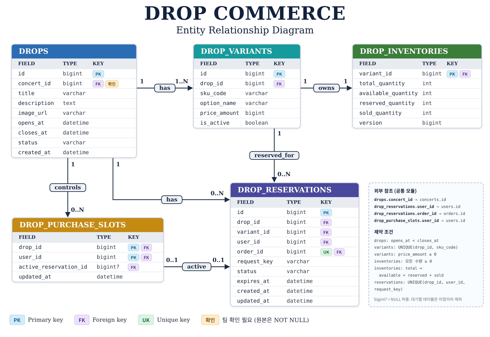

# Drop 데이터 모델

> 관련 코드: `backend/src/main/resources/db/migration/V*__drop_*.sql`, `backend/src/main/java/com/restless/drop/domain/`
>
> 마지막 확인: 2026-11-19 (#254 SKU별 대기열 migration과 대조. 나머지는 2026-11-14 #92 구현과 대조)

아래는 논리 모델이다. 실제 DDL은 `backend/src/main/resources/db/migration/`의 `V*__drop_*.sql`이 정본이다.

## DROPS

대표 상품과 판매 기간

| 컬럼 | 의미 |
|---|---|
| id | PK |
| concert_id | 공연 FK. 현재 구현은 필수(NOT NULL FK, 등록 API도 필수). NULL 허용으로 바꿀지는 팀 확인 ([열린 결정](../../product/open-questions.md)) |
| title | 상품명 |
| description | 설명 |
| image_url | 대표 이미지 |
| status | 판매 상태 |
| opens_at | 판매 시작 |
| closes_at | 판매 종료 |
| created_at | 등록 시각 |

제약: `CHECK (opens_at < closes_at)`

## DROP_VARIANTS

SKU, 옵션

| 컬럼 | 의미 |
|---|---|
| id | PK |
| drop_id | Drop FK |
| sku_code | SKU 코드 |
| option_name | FREE, S, M, L 등 |
| price_amount | 원 단위 정수 가격 |
| is_active | 옵션 활성 여부 |

제약: `UNIQUE(drop_id, sku_code)`, `CHECK(price_amount >= 0)`. 등록 API는 1원 이상만 받는다(#92). DB 제약은 이미 있는 행 때문에 그대로 둔다

- `is_active`가 false면 재고가 있어도 신규 예약할 수 없다.
- 판매 시작 후 가격, 옵션 변경은 제한한다.

## DROP_INVENTORIES

SKU별 재고

| 컬럼 | 의미 |
|---|---|
| variant_id | PK, FK |
| total_quantity | 총재고 |
| available_quantity | 신규 예약 가능 |
| reserved_quantity | 예약 중 |
| sold_quantity | 순판매 확정 |
| version | 낙관적 락용 (조건부 UPDATE만 쓰면 불필요) |

제약: 재고 음수 금지, 총재고 보존 (INV-01, INV-02)

## DROP_RESERVATIONS

재고 예약과 구매 결과 이력

| 컬럼 | 의미 |
|---|---|
| id | PK |
| drop_id | Drop FK |
| variant_id | SKU FK |
| user_id | Member FK |
| order_id | Order FK |
| request_key | 멱등성 키. `utf8mb4_0900_bin`이라 대소문자·악센트를 구분한다 (V20261113_1701) |
| status | 예약 상태 |
| expires_at | 만료 시각 |
| current_payment_id | 승인 시작을 받아들인 현재 결제 시도 (`payments.id`, Nullable, 물리 FK 없음). V20261113_1700에서 추가 |
| created_at, updated_at | 생성, 변경 시각 |

제약: `UNIQUE(order_id)`, `UNIQUE(drop_id, user_id, request_key)`. 만료 작업용 인덱스 `ix_drop_reservations_expiry (status, expires_at)`

`current_payment_id`는 재결제 때 새 시도로 바뀐다. 결제 결과의 `paymentId`와 비교해 다른 시도의 결과를 거른다 (INV-15).

같은 멱등성 키로 다른 요청 내용이 오는 경우를 잡으려면 요청 해시 컬럼을 추가할 수 있다.

## DROP_PURCHASE_SLOTS

사용자별 동시 활성 구매 제한 (INV-05)

| 컬럼 | 의미 |
|---|---|
| drop_id | 복합 PK |
| user_id | 복합 PK |
| active_reservation_id | 진행 중 예약 (Nullable) |
| updated_at | 갱신 시각 |

슬롯은 DB 트랜잭션에서 원자적으로 점유, 해제한다.

## DROP_QUEUE_ENTRIES (DECIDED, D4)

> SKU별 대기열은 `V20261119_1800__drop_sku_queue_expand.sql`, `V20261119_1801__drop_sku_queue_backfill.sql`, `V20261119_1802__drop_sku_queue_constrain.sql`로 구현했다(#254). 기존 활성 대기는 CLOSED로 닫고, 소비된 이력은 연결된 점유 SKU를 우선 사용한다. 나머지 이력은 해당 드롭의 첫 SKU를 역사적 FK로 지정하며 기존 순번이나 구매권은 복구하지 않는다. SKU가 없는 비정상 드롭은 NOT NULL 검증에서 실패하므로 migration 전에 점검한다.

- `id`: 서버가 발급하는 증가 PK. 대략적인 진입 순서에도 사용한다.
- `drop_id`, `user_id`: 드롭·회원 FK.
- `variant_id`: 대기열 진입 때 고른 SKU(`drop_variants.id`) FK. NOT NULL. 대기 순서, 입장 수 계산, 구매권 귀속의 기준이다.
- `status`: WAITING / ADMITTED / CONSUMED / EXPIRED / CLOSED / UNAVAILABLE. 현재 구매 불가로 종료한 대기를 위한 상태 `UNAVAILABLE`을 추가한다(이름 결정 2026-11-19, [policy.md 7-1절](policy.md#7-1-sku별-구매-입장-대기열-decided-2026-11-19-253)). CHECK 제약 `ck_drop_queue_status`도 이 값을 허용한다. 종료는 행 삭제가 아니라 이 컬럼의 변경이다.
- `entered_at`, `last_seen_at`: 진입 시각과 마지막 상태 조회 시각.
- `admitted_at`, `admitted_until`, `consumed_at`: 입장·구매권 만료·소비 시각.
- `active_user_id`: WAITING 또는 ADMITTED일 때만 user_id인 생성 컬럼.
- `UNIQUE(drop_id, active_user_id)`: 회원과 드롭당 살아 있는 대기(`WAITING`, `ADMITTED`)는 최대 1건. 종료된 행은 이 키에서 빠지므로 재고가 반환된 뒤 새 행으로 다시 진입할 수 있다. SKU별이어도 INV-05(드롭당 활성 구매 1건)에 맞춰 유지하는 안이다. SKU를 바꿔 다시 들어오면 기존 행을 `CLOSED`로 바꾼 뒤(키에서 빠진다) 새 행을 만든다. 같은 트랜잭션에서 먼저 flush해야 키가 겹치지 않는다.
- SKU별 입장은 `(variant_id, status, id)` 인덱스와 `FOR UPDATE SKIP LOCKED`로 고른다. `(variant_id, status, admitted_until)`로 유효 ADMITTED를 센다. 종료 대상은 같은 SKU의 살아 있는 행을 `FOR UPDATE`로 읽어 건너뛰지 않는다.
- 입장 가능 수 계산 `max(0, available - 미사용 유효 ADMITTED 수)`는 `drop_inventories.available_quantity`와 이 표의 `ADMITTED` 행을 함께 읽는다. 두 값을 읽고 발급하는 사이에 다른 입장 작업이 끼어들지 못해야 한다 (INV-16, [transactions.md](transactions.md) D4).
- `WAITING`의 순서는 `id`(애플리케이션 대기 순서)이며 DB 락 획득 순서가 아니다. 재진입은 새 `id`를 받으므로 항상 뒤에 선다.
- 회원별 최신 상태는 `(drop_id, user_id, id)`, 전체 대기 Gauge는 `(status, last_seen_at)` 인덱스를 사용한다.
- 만료, 소비, 종료 이력은 조회할 수 있으며, 재진입하면 새 행을 추가한다. 종료된 순번과 구매권은 복구하지 않는다. CLOSED 이력만 있으면 상태 조회는 404다. 최신 행이 `UNAVAILABLE`이면 404가 아니라 그 상태를 돌려준다.

## DROP_QUEUE_GATES

- `variant_id`: PK이자 `drop_variants.id` FK. SKU마다 한 행.
- 입장과 종료 batch만 `FOR UPDATE SKIP LOCKED`로 락 획득한다. 게이트가 사용 중이면 즉시 건너뛰고 다음 주기에 재시도한다.
- gate row lock은 transaction 종료 시 자동 해제된다. TX1과 PG 호출은 이 게이트를 사용하지 않는다.
- 기존 SKU는 expand migration에서, 새 SKU는 운영자 생성 transaction에서 게이트를 만든다. 작업이 누락 gate를 발견하면 로그와 `drop.queue.gate.missing` 합계를 남기고 별도 짧은 transaction의 INSERT IGNORE로 보완한 뒤 한 번 재시도한다.

## 공통 테이블 (Drop 소유 아님)

USERS/Member Profile, CONCERTS, ORDERS, ORDER_ITEMS, ORDER_SHIPPING_SNAPSHOTS, PAYMENTS, PAYMENT_REFUNDS

Drop은 Order, Payment Repository를 직접 수정하지 않는다. 공통 Application Service 또는 Coordinator를 통해 조정한다.
