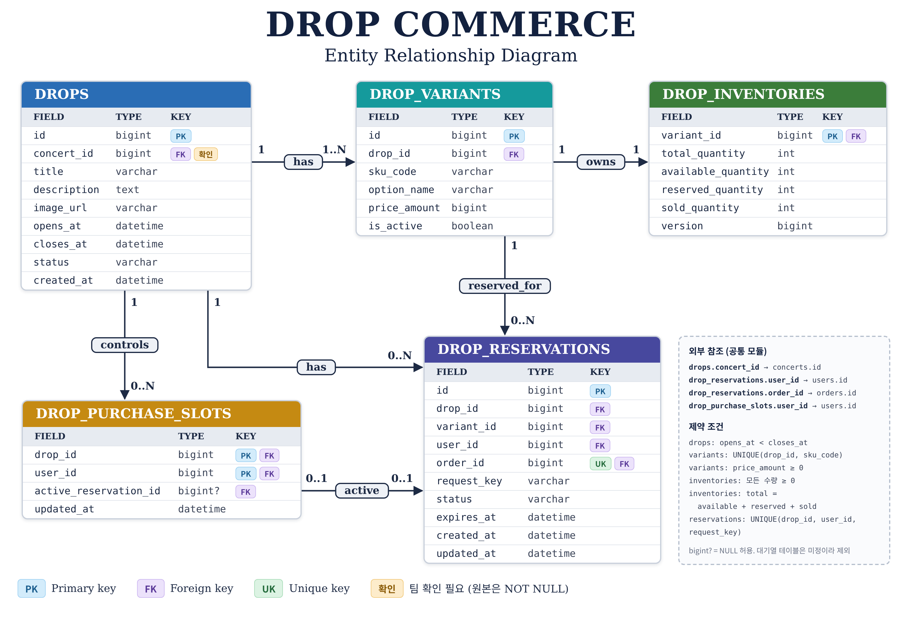

# Drop 데이터 모델

> 관련 코드: `backend/src/main/resources/db/migration/V*__drop_*.sql`, `backend/src/main/java/com/restless/drop/domain/`
>
> 마지막 확인: 2026-11-14 (#92 등록 검증·판매 상태 구현과 대조)

아래는 논리 모델이다. 실제 DDL은 `backend/src/main/resources/db/migration/`의 `V*__drop_*.sql`이 정본이다.

## DROPS

대표 상품과 판매 기간

| 컬럼 | 의미 |
|---|---|
| id | PK |
| concert_id | 공연 FK. 현재 구현은 필수(NOT NULL FK, 등록 API도 필수). NULL 허용으로 바꿀지는 팀 확인 ([열린 결정](../../product/open-questions.md)) |
| title | 상품명 |
| description | 설명 |
| image_url | 대표 이미지 |
| status | 판매 상태 |
| opens_at | 판매 시작 |
| closes_at | 판매 종료 |
| created_at | 등록 시각 |

제약: `CHECK (opens_at < closes_at)`

## DROP_VARIANTS

SKU, 옵션

| 컬럼 | 의미 |
|---|---|
| id | PK |
| drop_id | Drop FK |
| sku_code | SKU 코드 |
| option_name | FREE, S, M, L 등 |
| price_amount | 원 단위 정수 가격 |
| is_active | 옵션 활성 여부 |

제약: `UNIQUE(drop_id, sku_code)`, `CHECK(price_amount >= 0)`. 등록 API는 1원 이상만 받는다(#92). DB 제약은 이미 있는 행 때문에 그대로 둔다

- `is_active`가 false면 재고가 있어도 신규 예약할 수 없다.
- 판매 시작 후 가격, 옵션 변경은 제한한다.

## DROP_INVENTORIES

SKU별 재고

| 컬럼 | 의미 |
|---|---|
| variant_id | PK, FK |
| total_quantity | 총재고 |
| available_quantity | 신규 예약 가능 |
| reserved_quantity | 예약 중 |
| sold_quantity | 순판매 확정 |
| version | 낙관적 락용 (조건부 UPDATE만 쓰면 불필요) |

제약: 재고 음수 금지, 총재고 보존 (INV-01, INV-02)

## DROP_RESERVATIONS

재고 예약과 구매 결과 이력

| 컬럼 | 의미 |
|---|---|
| id | PK |
| drop_id | Drop FK |
| variant_id | SKU FK |
| user_id | Member FK |
| order_id | Order FK |
| request_key | 멱등성 키. `utf8mb4_0900_bin`이라 대소문자·악센트를 구분한다 (V20261113_1701) |
| status | 예약 상태 |
| expires_at | 만료 시각 |
| current_payment_id | 승인 시작을 받아들인 현재 결제 시도 (`payments.id`, Nullable, 물리 FK 없음). V20261113_1700에서 추가 |
| created_at, updated_at | 생성, 변경 시각 |

제약: `UNIQUE(order_id)`, `UNIQUE(drop_id, user_id, request_key)`. 만료 작업용 인덱스 `ix_drop_reservations_expiry (status, expires_at)`

`current_payment_id`는 재결제 때 새 시도로 바뀐다. 결제 결과의 `paymentId`와 비교해 다른 시도의 결과를 거른다 (INV-15).

같은 멱등성 키로 다른 요청 내용이 오는 경우를 잡으려면 요청 해시 컬럼을 추가할 수 있다.

## DROP_PURCHASE_SLOTS

사용자별 동시 활성 구매 제한 (INV-05)

| 컬럼 | 의미 |
|---|---|
| drop_id | 복합 PK |
| user_id | 복합 PK |
| active_reservation_id | 진행 중 예약 (Nullable) |
| updated_at | 갱신 시각 |

슬롯은 DB 트랜잭션에서 원자적으로 점유, 해제한다.

## DROP_QUEUE_ENTRIES (DECIDED, D4)

- `id`: 서버가 발급하는 증가 PK. 대략적인 진입 순서에도 사용한다.
- `drop_id`, `user_id`: 드롭·회원 FK.
- `status`: WAITING / ADMITTED / CONSUMED / EXPIRED / CLOSED.
- `entered_at`, `last_seen_at`: 진입 시각과 마지막 상태 조회 시각.
- `admitted_at`, `admitted_until`, `consumed_at`: 입장·구매권 만료·소비 시각.
- `active_user_id`: WAITING 또는 ADMITTED일 때만 user_id인 생성 컬럼.
- `UNIQUE(drop_id, active_user_id)`: 회원·드롭당 살아 있는 대기는 최대 1건.
- 입장 인덱스 `(drop_id, status, id)`와 `FOR UPDATE SKIP LOCKED`로 여러 작업의 입장 대상이 겹치지 않게 한다. 엄격한 FIFO는 보장하지 않는다.
- 회원별 최신 상태는 `(drop_id, user_id, id)`, 전체 대기 Gauge는 `(status, last_seen_at)` 인덱스를 사용한다.
- 만료·소비 이력은 조회할 수 있으며, 재진입하면 새 행을 추가한다. CLOSED 이력만 있으면 상태 조회는 404다.

## 공통 테이블 (Drop 소유 아님)

USERS/Member Profile, CONCERTS, ORDERS, ORDER_ITEMS, ORDER_SHIPPING_SNAPSHOTS, PAYMENTS, PAYMENT_REFUNDS

Drop은 Order, Payment Repository를 직접 수정하지 않는다. 공통 Application Service 또는 Coordinator를 통해 조정한다.
