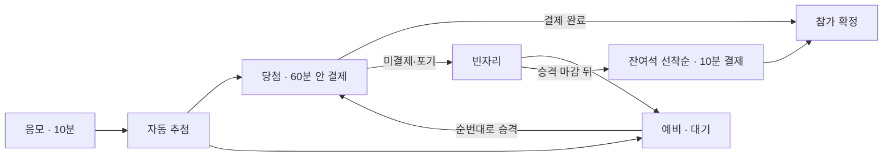

# Fan Meeting 도메인

담당자: 홍승연

| 문서 | 내용 |
|---|---|
| [policy.md](policy.md) | 목표, 범위, 사용자 시나리오, 기능·비기능 요구사항, 비즈니스 정책 |
| [invariants.md](invariants.md) | INV-01 ~ INV-07 |
| [state-machines.md](state-machines.md) | 행사, 선발, 주문 상태와 선발·주문 짝 |
| [transactions.md](transactions.md) | 응모·마감, 추첨, 결제, 포기 경합, 만료·승격, 잔여석 |

관련: [API 계약](../../contracts/api/fanmeeting.md), [이벤트 계약](../../contracts/events/fanmeeting.md), [통합 ERD](../../architecture/erd.md)

## 한 줄 요약

공지한 시간대에 깜짝 오픈하는 10분 응모를 받고, 마감 뒤 자동 추첨으로 당첨·예비를 정한다. 당첨자는 60분 안에 결제하고, 빈자리는 예비자가 순번대로 이어받는다. 승격 마감 뒤 남은 자리는 미선발 응모자에게 선착순으로 판다 (P1).

## 테이블

| 테이블 | 역할 |
|---|---|
| `fan_meeting_events` | 정원·예비 수·참가비·응모/승격 마감 시각. 동시성 제어의 기준 행 |
| `fan_meeting_applications` | 회원별 응모 (APPLIED / WITHDRAWN) |
| `fan_meeting_draw_runs` | 추첨 1회, seed, lease |
| `fan_meeting_selections` | 당첨(WINNER)·예비(RESERVE)·잔여석(LEFTOVER) 선발과 상태 |
| `fan_meeting_orders` | 결제 기회, 기한, 결제 연결. 팬미팅 전용 주문 테이블이다 (공통 `orders` 아님) |

응모 하나는 최대 한 번 선발되고, 선발 하나는 최대 하나의 주문을 가진다. 컬럼과 제약은 [통합 ERD](../../architecture/erd.md)와 `V20261111_1020__fanmeeting_create_tables.sql`에 있다.

## 원본

담당자 팀 명세(`FANMEETING_TEAM_SPEC` [3]~[8])를 옮겼다. 원본은 "전체 불변식 18개와 검증 테스트는 상세 설계 문서에 있다"고 하지만 그 문서는 아직 저장소에 없다.
