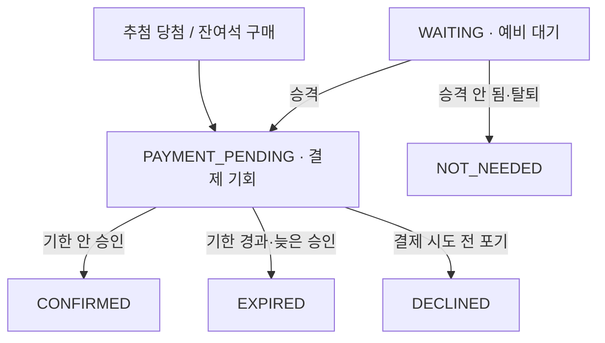
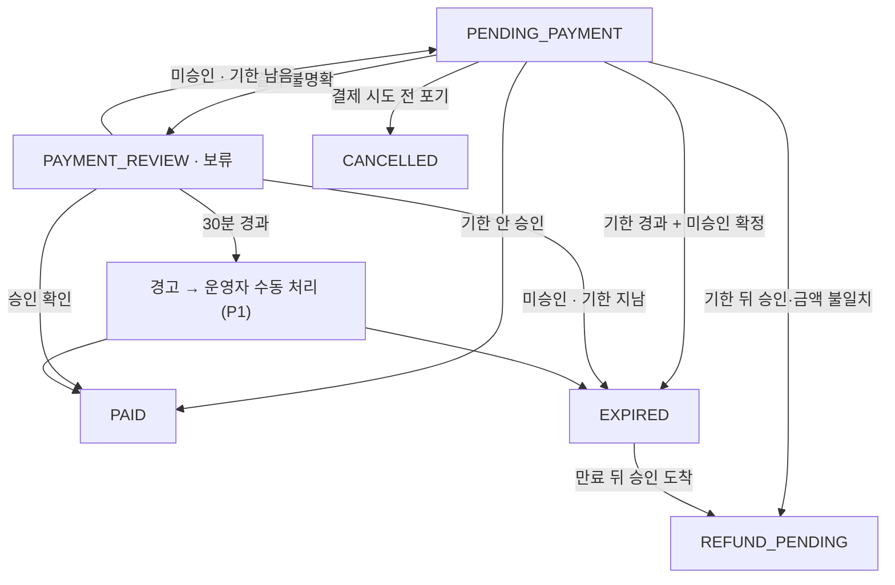

# Fan Meeting 상태 머신

행사, 선발, 주문 상태는 따로 저장하고, 선발·주문 조합의 정합성을 검사한다.

## 1. 행사 상태

| 현재 | 사건 | 다음 |
|---|---|---|
| 없음 | 운영자 등록 | `SCHEDULED` |
| `SCHEDULED` | 응모 시작 시각 | `OPEN` |
| `OPEN` | 응모 마감 시각 | `CLOSED` |
| `CLOSED` | 추첨 시작 | `DRAWING` |
| `DRAWING` | 추첨 완료 | `PAYMENT_IN_PROGRESS` (응모 0명이면 `RECRUITMENT_COMPLETED`) |
| `PAYMENT_IN_PROGRESS` | 참가 자격이 모두 정해짐 | `RECRUITMENT_COMPLETED` |

## 2. 선발 상태

결과가 불명확한 동안 선발은 `PAYMENT_PENDING`을 유지해 자리를 지킨다.

## 3. 주문 상태

## 4. 선발·주문 짝

| 선발 | 가능한 주문 |
|---|---|
| `WAITING`, `NOT_NEEDED` | 없음 |
| `PAYMENT_PENDING` | `PENDING_PAYMENT`, `PAYMENT_REVIEW` |
| `CONFIRMED` | `PAID` |
| `EXPIRED` | `EXPIRED`, `REFUND_PENDING` |
| `DECLINED` | `CANCELLED` |

이 표에 없는 조합은 버그로 보고 정합성 SQL로 검사한다.

## 5. 보류 처리

보류는 돈이 나갔는지 모르는 상태라 시간이 지나도 자동으로 확정하거나 탈락시키지 않는다. 1분마다 다시 조회하고, 30분이 넘으면 경고를 남겨 운영자가 PG 화면을 확인한 뒤 같은 판정 규칙으로 처리한다 (P1).
