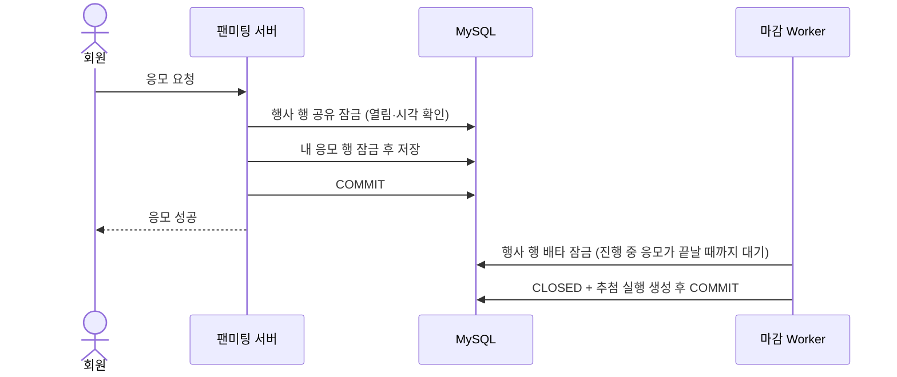
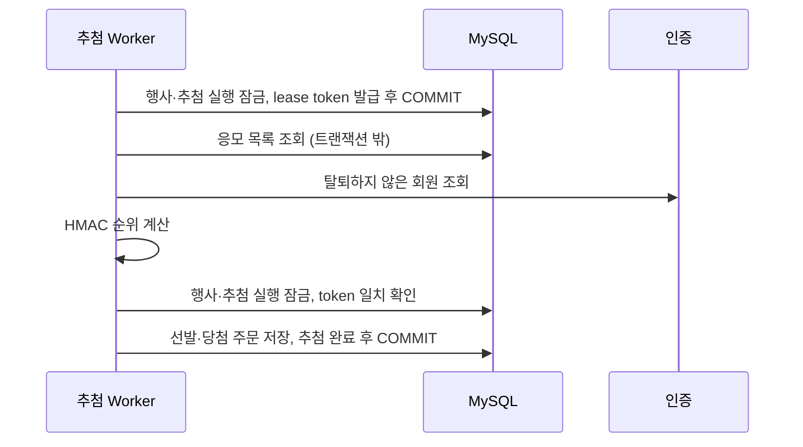
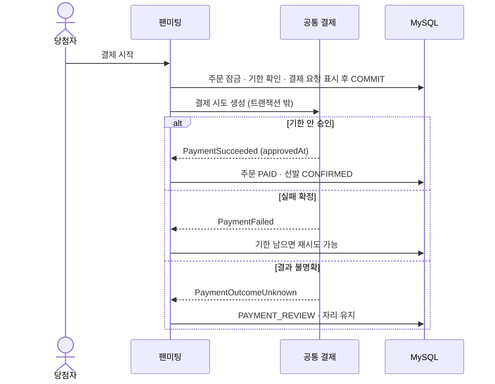
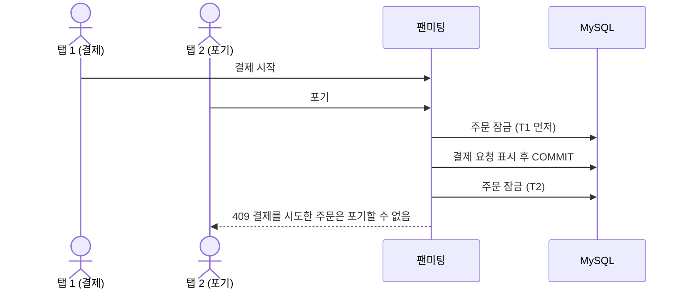
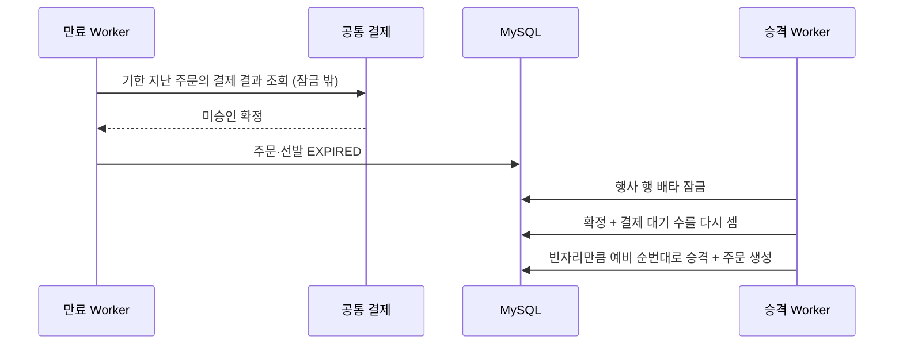
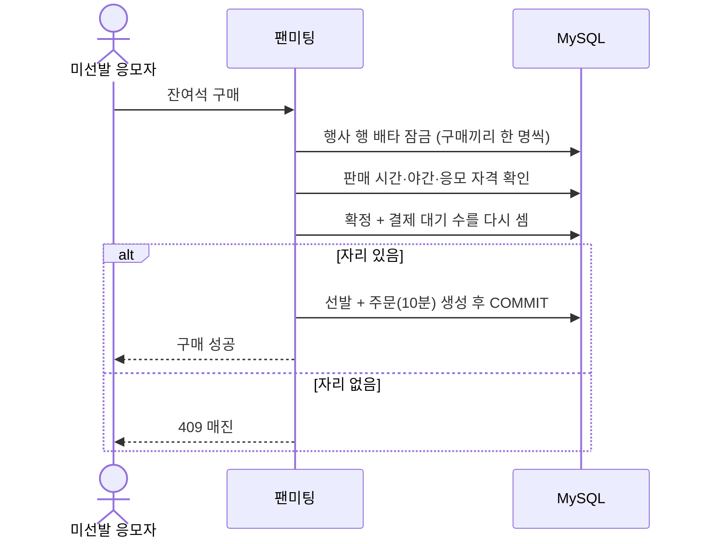

# Fan Meeting 트랜잭션과 시퀀스

공통 규칙:

- 동시성 제어의 기준은 행사(`fan_meeting_events`) 행이다. 잠금 순서는 고정한다 (FM-NFR-05).
- 결제 호출과 결제 결과 조회는 DB 잠금을 쥔 트랜잭션 밖에서 실행한다.
- 주문과 선발 상태는 같은 트랜잭션에서 바꾼다.

## 1. 응모와 마감

응모끼리는 공유 잠금이라 서로 기다리지 않는다. 마감만 배타 잠금으로 진행 중 응모를 기다린 뒤 닫는다.

## 2. 추첨

다른 Worker가 lease를 가져간 뒤 늦게 끝난 Worker는 token이 달라 저장하지 못한다.

## 3. 결제 및 참가 확정

## 4. 결제 포기와 결제 시작의 경합

둘 다 주문 행을 먼저 잠그므로 둘 중 하나만 성공한다.

## 5. 만료와 예비 승격

결제 결과가 불명확하면 기한이 지났다는 이유만으로 만료하지 않는다.

## 6. 잔여석 구매 (P1)

남은 좌석 수를 따로 저장하지 않는다. 만료·포기된 자리는 다음 구매자가 셀 때 자동으로 돌아온다.
