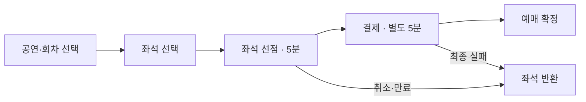
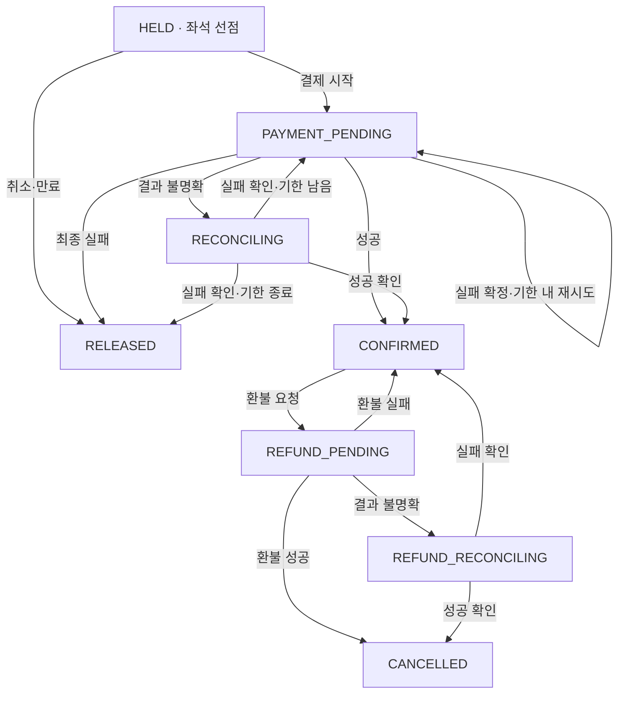
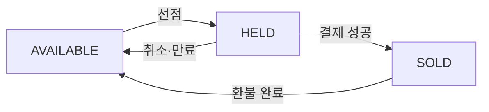
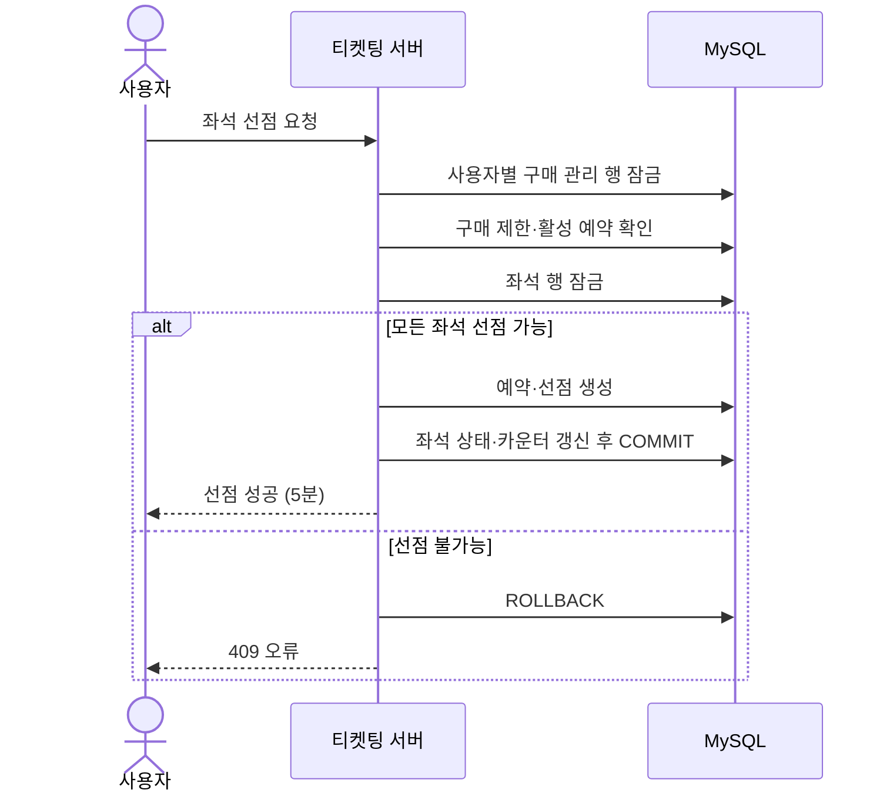
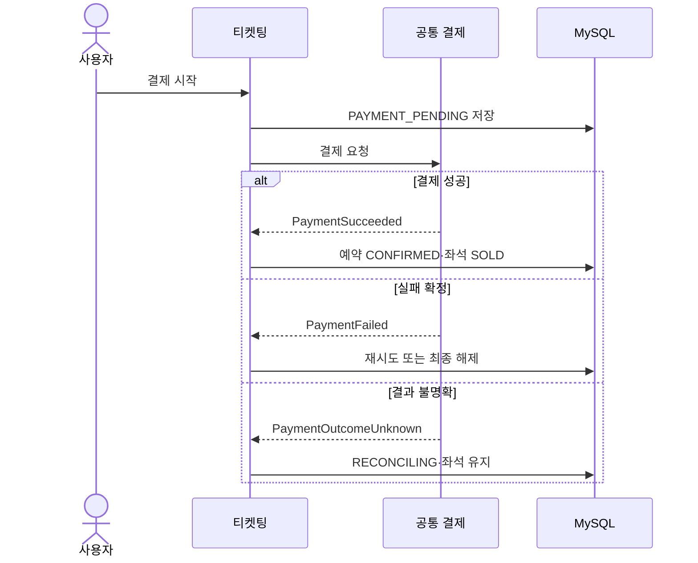
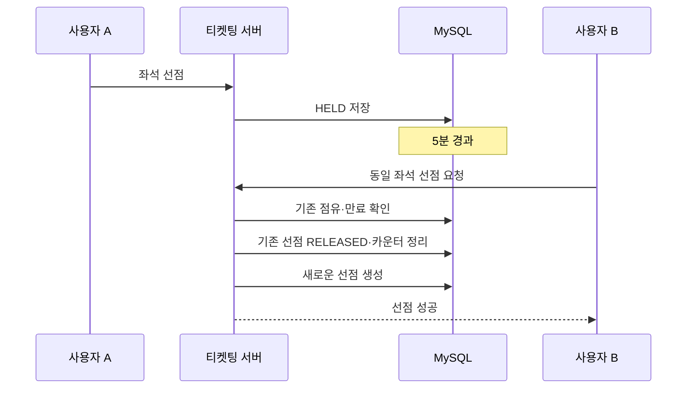
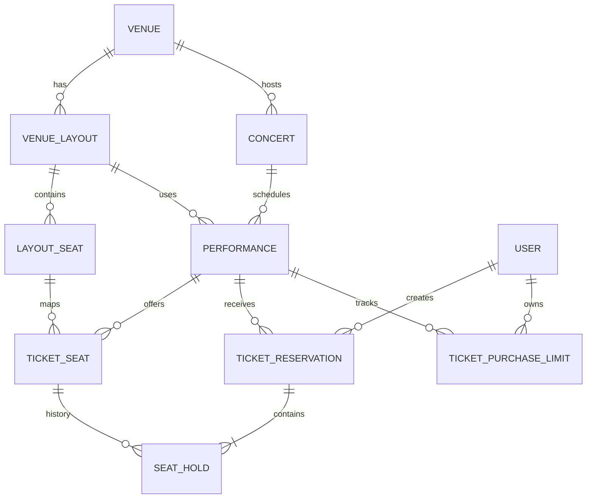
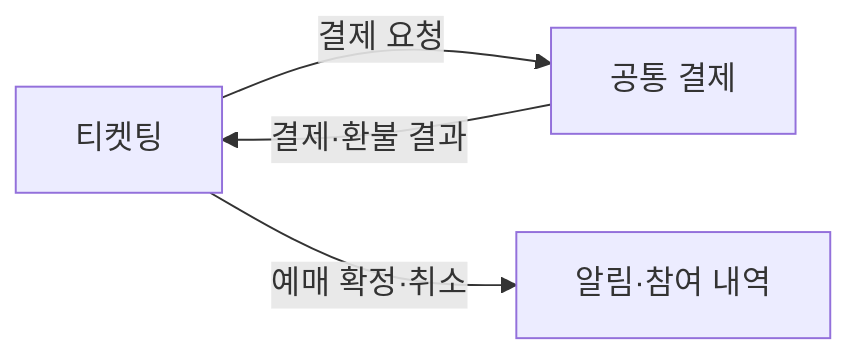

> 구현 범위 변경: 전용 멱등성 테이블·실행권·접수 작업 자동 인계는 후속 구현이다. MVP 중복 방지와 PG 결과 재확인은 유지한다. [단계별 범위](idempotency.md) 참고 (DECIDED, 2026-11-12).
> 구매 제한과 사용자·회차별 활성 예약 1건은 [purchase-limit.md](purchase-limit.md)의 관리 행 잠금·상태별 수량 규칙을 따른다 (DECIDED, 2026-11-12).
> 승인 시작·성공·실패·불명확 시 예약 상태 전이는 [PaymentResultHandler 설계](payment-handler.md)를 따른다 (DECIDED, 2026-11-12). 시도 식별 전달 계약은 후속 합의 대상이다.
> MVP에서는 운영자가 공연장·배치를 사전 등록하고 배치는 초기 데이터로 적재한다. 미등록 배치는 별도 요청 화면 없이 주최자 자료 전달·운영자 검토 후 등록하며, 주최자는 등록된 배치를 선택한다. 예매 오픈 이후 회차 배치 변경은 금지한다. [배치 정책](venue-consistency.md) 참고 (DECIDED, 2026-11-12).
> 공연장 소속과 회차 배치 정합성은 [venue-consistency.md](venue-consistency.md)를 따른다 (DECIDED, 2026-11-12).
> 멱등성 키 범위는 사용자 + 작업 종류 + 요청 키로 확정했다. [멱등성 계약](idempotency.md)을 따른다 (DECIDED, 2026-11-12).
> 예약 만료는 [expiration.md](expiration.md)가 정본이다 (DECIDED, 2026-11-12). 결제 진입 후 승인 시도 없음·모두 실패는 결제 기한에 반환하고, 진행 중·불명확 시도는 보호한다.
> 결제 결과 불명확이 5분 지속되면 운영 확인으로 전환하고 자동 조회·좌석 보호를 계속한다. 상세는 [transactions.md](transactions.md)를 따른다 (DECIDED, 2026-11-12).
> 결제 확정 경계는 [transactions.md](transactions.md)가 정본이다 (DECIDED, 2026-11-12). 아래 결제 결과 이벤트 초안은 핵심 상태 확정을 AFTER_COMMIT 리스너에 위임한다는 의미가 아니다. 결제 기한은 서버의 유효한 승인 시도 기록 시점을 기준으로 한다. 기한 내 기록·커밋된 시도는 성공 확인이 늦어져도 확정한다.
> MySQL 좌석 소유권 설계는 [seat-ownership.md](seat-ownership.md)가 정본이다 (DECIDED, 2026-11-12).
> 티켓번호는 [티켓 발급 설계](ticket-issuance.md)에 따라 UUID v4로 발급한다 (DECIDED, 2026-11-12). 동일 예약·좌석의 복합 UNIQUE와 잠금 기반 중복 발급 방지도 확정했다.
> 아래 Notion 원본의 엔티티명은 통합 ERD의 실제 테이블명과 구분한다. DB는 ADR-0002에 따라 MySQL 8이다.

## [3] MVP 범위 및 핵심 사용자 시나리오

### 개발 목표

공연 좌석을 선택하고, 일정 시간 선점한 뒤 결제를 통해 예매를 확정하는 서비스를 구현한다.

**핵심 목표:** 동시 예매 상황에서도 좌석 중복 판매를 방지하고, 대규모 트래픽에 대응하는 방법을 비교·검증한다.

### 사용자 예매 흐름



**P0 · 필수**

공연·좌석 조회, 선점, 구매 제한, 결제, 환불, 예약 복구, 동시성 제어

**P1 · 확장**

Redis 대기열, 잠금 방식 성능 비교, SSE 실시간 갱신

MVP에서는 **지정석만 지원**하며, 비지정석·티켓 양도·부분 환불·좌석 자동 추천은 제외한다.

## [4] 기능 및 요구사항


| 핵심 기능 | 요구사항                        |
| ----- | --------------------------- |
| 좌석 조회 | 3초마다 좌석 상태 갱신               |
| 좌석 선점 | 다중 좌석 전체 성공 또는 전체 실패        |
| 구매 제한 | 회차별 N매 제한, 분할 구매 가능         |
| 예약 관리 | 회차당 진행 중 예약 최대 1건, 재접속 시 복구 |
| 결제·환불 | 성공·실패·결과 불명확 상황 처리          |
| 만료 처리 | 5초 스케줄러 + 요청 시 검증           |
| 멱등성   | 동일 요청 재시도 시 중복 예약 방지        |


### 비기능 요구사항


| 항목          | 목표·지표   |
| ----------- | ------- |
| 중복 판매·초과 구매 | 0건      |
| 다중 좌석 원자성   | 100%    |
| 성능 측정 지표    | p95/p99 |


위 수치는 **달성 목표**이며, 동시성 테스트와 부하 테스트로 검증할 예정이다.

## [5] 비즈니스 정책 및 불변식

### 핵심 정책

예매 시간 정책


| 정책       | 기준                      |
| -------- | ----------------------- |
| 좌석 선점    | 5분, 새로고침해도 연장되지 않음      |
| 결제       | 결제 시작 후 별도 5분           |
| 구매 제한    | 회차별 1인 N매, 여러 번 구매 가능   |
| 활성 예약    | 사용자·회차당 최대 1건           |
| 예매·환불 마감 | 공연 시작 1시간 전             |
| 좌석 변경    | 기존 선점 취소 후 새로 선점        |
| 대기열(P1)  | 예매 10분 전 오픈, 입장권 15분 유효 |


### 시스템 불변식

어떤 동시 요청 상황에서도 반드시 지켜야 하는 조건

**한 좌석 = 하나의 유효 점유**

동일 좌석의 중복 선점·판매 금지

---

**확정 수량 + 선점 수량 ≤ 구매 제한**

여러 번 구매하더라도 회차별 제한 준수

---

**전체 성공 또는 전체 실패**

결제 결과 불명확 시 좌석 보호, 중복 처리 방지

## [6] 상태 머신

### 예약 상태 변화



결제 결과가 불명확한 상태에서는 좌석을 반환하지 않고 최종 결과를 확인한다.

### 좌석 상태 변화



선점 기록(`SeatHold`)은 `HELD`, `CONFIRMED`, `RELEASED`로 관리하고, 환불 후에도 과거 이력을 보존한다.

## [7] 주요 시퀀스 다이어그램

### 7.1 좌석 선점



**DB 잠금은 트랜잭션 동안만 유지**하고, 실제 5분 선점은 `HELD` 상태와 만료 시각으로 관리한다.

### 7.2 결제 및 예매 확정



결제 호출은 DB 잠금을 보유한 트랜잭션 밖에서 실행한다.

### 7.3 만료 및 재선점



단, 결제 진행 중이거나 결과 확인 중인 예약은 단순히 최초 선점 시간이 지났다는 이유로 해제하지 않는다.

## [8] ERD, API, 이벤트 계약

### 8.1 핵심 ERD



**핵심 설계:** 공연장 좌석 배치와 회차별 판매 좌석을 분리하고, 하나의 예약에 여러 좌석 선점 기록을 연결한다.


| 핵심 엔티티                | 역할             |
| --------------------- | -------------- |
| `Performance`      | 회차·예매 시간·구매 제한 |
| `TicketSeat`          | 회차별 좌석 상태      |
| `TicketReservation`   | 예약·결제 진행 상태    |
| `SeatHold`          | 좌석별 선점 이력      |
| `TicketPurchaseLimit` | 사용자별 선점·확정 수량  |


DB에서는 회차별 좌석 행을 잠근 뒤 현재 소유권을 검사·변경한다. UNIQUE 제약은 좌석 행 중복 등 구조적 오류를 방지한다. 상세 보장 범위는 [좌석 소유권 설계](seat-ownership.md)를 따른다.

### 8.2 주요 API


| API                                                | 기능    |
| -------------------------------------------------- | ----- |
| `GET /api/performances/{performanceId}/seats`             | 좌석 조회 (로그인 필수) |
| `POST /api/ticket-reservations`                    | 좌석 선점 |
| `GET /api/ticket-reservations/active`              | 예약 복구 |
| `DELETE /api/ticket-reservations/{id}`             | 선점 취소 |
| `POST /api/ticket-reservations/{id}/checkout`      | 결제 시작 |
| `POST /api/ticket-reservations/{id}/cancellations` | 환불 요청 |


좌석 선점 요청은 `seatIds: [10, 11]` 형태로 전달해 향후 1인 N매 구매에 대응한다. 동일 요청의 재시도는 `Idempotency-Key`로 보호한다.

### 8.3 이벤트 계약




| 구분  | 이벤트                          | 처리          |
| --- | ---------------------------- | ----------- |
| 수신  | `PaymentSucceeded`           | 예매 확정       |
| 수신  | `PaymentFailed`              | 재시도 또는 해제   |
| 수신  | `PaymentOutcomeUnknown`      | 좌석 보호·재확인   |
| 수신  | `RefundSucceeded`            | 환불 완료·좌석 반환 |
| 수신  | `RefundFailed`               | 기존 예매 유지    |
| 발행  | `TicketReservationConfirmed` | 예매 완료 알림    |
| 발행  | `TicketReservationCancelled` | 취소 알림       |


좌석 선점·취소·만료 이벤트는 필요 시 P1에서 추가한다. 핵심 결제 결과는 Coordinator가 트랜잭션 안에서 직접 조정하며, 발행 이벤트는 커밋 후 후속 작업에 사용한다.

---

- 상세
  ## [3] MVP 범위 및 핵심 사용자 시나리오
  ### 3.1 개발 목표

  공연 회차별 지정 좌석을 조회하고, 사용자가 원하는 좌석을 선점한 뒤 결제를 통해 예매를 확정할 수 있는 서비스를 구현한다.

  핵심 기술 목표는 동시 요청 상황에서 중복 선점과 중복 판매를 방지하고, DB 잠금 방식과 대기열 도입 효과를 정량적으로 비교하는 것이다.
  ### 3.2 MVP 범위
  
  | 구분     | 기능                        | 우선순위 |
  | ------ | ------------------------- | ---- |
  | 공연 조회  | 공연·회차·좌석 정보 조회            | P0   |
  | 좌석 선택  | 지정석 선택, 상태 조회             | P0   |
  | 좌석 선점  | 5분 임시 점유, 중복 방지           | P0   |
  | 예약 관리  | 활성 예약 조회, 복구, 취소          | P0   |
  | 구매 제한  | 회차별 구매 가능 수량 검증           | P0   |
  | 결제 연동  | 공통 결제 결과에 따른 예약 확정        | P0   |
  | 환불 연동  | 환불 완료 후 좌석 재판매            | P0   |
  | 만료 처리  | 5초 스케줄러 및 요청 시 만료 검증      | P0   |
  | 동시성 검증 | 비관적 락, Testcontainers 테스트 | P0   |
  | 성능 비교  | 비관적 락 vs 조건부 UPDATE       | P1   |
  | 대기열    | Redis FIFO, 입장 인원 제한      | P1   |
  | 실시간 개선 | SSE 기반 좌석 상태 갱신           | P1   |
  

  MVP 제외 범위: 비지정석, 공연장 좌석 배치 편집기, 부분 환불, 사용자 간 티켓 양도, 자동 좌석 추천.
  ### 3.3 핵심 사용자 시나리오
  1. 공연 탐색
  
     사용자가 공연을 선택하고 날짜별 공연 회차 및 좌석 배치를 확인한다.
  2. 예매 진입
  
     예매 오픈 시각 이후 좌석 선택 페이지에 접근한다. Redis 대기열 도입 후에는 오픈 10분 전부터 대기열 진입이 가능하다.
  3. 좌석 선택 및 선점
  
     사용자가 좌석을 선택하고 '선택 완료'를 누르면 서버가 구매 제한과 좌석 상태를 검증하고 5분 동안 선점한다.
  4. 결제 및 예매 확정
  
     선점 기한 내 결제를 시작하면 별도의 5분 결제 제한 시간이 시작된다. 결제 성공 시 좌석이 `SOLD`가 된다.
  5. 예약 복구
  
     새로고침이나 페이지 이탈 후 재접속하면 기존 예약과 남은 시간을 복구한다.
  6. 취소 및 환불
  
     공연 시작 1시간 전까지 취소·환불을 요청할 수 있으며, 환불이 확정되면 좌석을 재판매 가능 상태로 전환한다.
  ## [4] 기능 정의 및 요구사항 정의
  ### 4.1 기능 요구사항
  
  | ID        | 기능       | 요구사항                      |
  | --------- | -------- | ------------------------- |
  | TKT-FR-01 | 공연 회차 조회 | 공연별 회차와 예매 가능 시간 제공       |
  | TKT-FR-02 | 좌석 조회    | 회차별 좌석 위치·가격·상태 조회        |
  | TKT-FR-03 | 좌석 선점    | 요청한 모든 좌석을 원자적으로 선점       |
  | TKT-FR-04 | 구매 제한    | 확정+선점+요청 수량이 제한 이하인지 검증   |
  | TKT-FR-05 | 활성 예약 제한 | 사용자·회차별 진행 중 예약 1건 허용     |
  | TKT-FR-06 | 멱등성      | 동일 키·동일 요청 재시도 시 기존 결과 반환 |
  | TKT-FR-07 | 선점 만료    | 최초 선점/별도 결제 기한과 승인 시도 상태에 따라 해제 |
  | TKT-FR-08 | 결제 연동    | 결제 성공·실패·불명확 상태 처리        |
  | TKT-FR-09 | 결제 재시도   | 기존 결제 기한 내 재시도 허용         |
  | TKT-FR-10 | 예약 복구    | 활성 예약과 서버 기준 만료 시각 제공     |
  | TKT-FR-11 | 선점 취소    | 선점 이력 보존 및 좌석 해제          |
  | TKT-FR-12 | 환불       | 환불 확정 후 구매 수량 복구 및 재판매    |
  | TKT-FR-13 | 좌석 상태 갱신 | 최초 3초 폴링                  |
  | TKT-FR-14 | 대기열      | Redis FIFO 및 입장 권한 검증(P1) |
  
  ### 4.2 비기능 요구사항
  
  | ID         | 항목  | 요구사항                        |
  | ---------- | --- | --------------------------- |
  | TKT-NFR-01 | 정합성 | 중복 선점 및 중복 판매 0건            |
  | TKT-NFR-02 | 원자성 | 다중 좌석 요청은 전체 성공 또는 전체 실패    |
  | TKT-NFR-03 | 멱등성 | 동일 요청 재시도로 중복 예약·결제 방지      |
  | TKT-NFR-04 | 동시성 | MySQL 비관적 락 적용         |
  | TKT-NFR-05 | 성능  | p95, p99, RPS, 오류율, 락 대기 측정 |
  | TKT-NFR-06 | 복구  | 결제 결과 불명확 시 좌석 유지 및 재확인     |
  | TKT-NFR-07 | 보안  | 본인 예약만 조회·변경 가능             |
  | TKT-NFR-08 | 확장성 | 구매 제한 N매 및 Redis 대기열 확장 가능  |
  

  락 대기 제한은 초기 1초로 설정하되, 실제 적절한 값은 부하 테스트로 검증한다.
  ## [5] 비즈니스 정책 및 불변식
  ### 5.1 확정된 비즈니스 정책
  
  | 영역         | 정책                      |
  | ---------- | ----------------------- |
  | 좌석 유형      | 지정석만 지원                 |
  | 구매 제한      | 회차별 `maxTicketsPerUser` |
  | 분할 구매      | 구매 제한 이내에서 여러 번 구매 가능   |
  | 활성 예약      | 사용자·회차별 최대 1건           |
  | 다중 좌석 선점   | All-or-Nothing          |
  | 좌석 선점      | 5분, 재접속해도 연장 없음         |
  | 결제         | 결제 시작 후 별도 5분           |
  | 결제 재시도     | 실패 확정 시 남은 기한 내 허용      |
  | 대기열 오픈     | 예매 시작 10분 전             |
  | 예매 시작      | 지정된 오픈 시각 정각            |
  | 예매 마감      | 공연 시작 1시간 전             |
  | 마감 전 생성 예약 | 기한 내 유효 승인 시도 기록, 결과 확인은 이후도 허용        |
  | 환불 요청 마감   | 공연 시작 1시간 전             |
  | 환불 후 재판매   | 환불 확정 즉시 좌석 해제          |
  | 선점 이력      | 삭제하지 않고 보존              |
  | 좌석 변경      | 기존 선점 취소 후 새 예약 생성      |
  | 예약 복구      | 기존 활성 예약 조회 및 복구        |
  | 좌석 갱신      | 3초 폴링                   |
  | 만료 처리      | 5초 스케줄러 + 요청 시 검증       |
  | DB 잠금      | 비관적 락, 좌석 ID 오름차순       |
  | 대기열 입장권    | 입장 허가 후 15분 유효          |
  
  ### 5.2 시스템 불변식

  다음 조건은 어떠한 동시 요청 상황에서도 반드시 지켜져야 한다.

  **INV-01. 좌석당 유효 점유는 최대 하나**
  - 하나의 좌석은 동시에 하나의 예약만 선점할 수 있다.
  - `좌석별 활성 선점 수 ≤ 1`

  **INV-02. 사용자 구매 제한**
  - 확정 구매 수량과 선점 수량의 합은 회차별 구매 제한을 초과할 수 없다.
  - `확정 구매 수량 + 선점 수량 ≤ 회차별 최대 구매 수량`

  **INV-03. 사용자·회차별 활성 예약은 최대 하나**
  - 동일 사용자는 같은 공연 회차에서 진행 중인 예약을 최대 1건만 가질 수 있다.
  - `사용자·회차별 활성 예약 수 ≤ 1`
  - 활성 예약 상태: `HELD`, `PAYMENT_PENDING`, `RECONCILING`

  **INV-04. 다중 좌석 선점의 원자성**
  - 요청한 좌석 중 하나라도 선점할 수 없다면 전체 요청을 실패 처리한다.
  - 일부 좌석만 선점되는 상황은 허용하지 않는다(All-or-Nothing).

  **INV-05. 결제 결과 불명확 시 좌석 보호**
  - 결제 또는 환불 결과가 불명확한 경우 좌석을 임의로 해제하지 않는다.
  - `RECONCILING`, `REFUND_RECONCILING` 상태에서는 결과 확인 전까지 좌석 점유를 유지한다.

  **INV-06. 구매 수량의 일관성**
  - `reserved_count`와 `confirmed_count`는 실제 예약·구매 상태와 일치해야 한다.
  - 두 값은 0 이상이어야 하며, 중복 요청으로 수량이 이중 반영되어서는 안 된다.

  **INV-07. 예매 시간 검증**
  - 예매 시작 전 또는 마감 후에는 신규 좌석 선점을 허용하지 않는다.
  - 단, 마감 전에 생성한 유효한 예약은 선점 기한 내 결제에 진입하고 결제 기한 내 유효 승인 시도를 기록할 수 있다. 해당 시도의 성공 확인은 기한 이후에도 허용한다.
  ## [6] 상태 머신
  ### 6.1 예약 상태 머신

  

  `RECONCILING`에서 실패가 확정되었을 때 결제 기한이 남아 있다면 `PAYMENT_PENDING`으로 복귀해 재시도를 허용한다.

  기한 내 서버에 기록·커밋된 유효 승인 시도는 성공 통지가 늦어도 확정한다. 상세 기한 판정과 예외는 [transactions.md 8절](transactions.md#8-결제-기한-인정-기준-decided-2026-11-12)을 따른다.
  ### 6.2 좌석 상태 머신

  .png)

  `TicketSeat`의 `HELD`는 결제 진행 중에도 유지된다. 결제 결과가 불명확한 경우에도 마찬가지다.
  ### 6.3 선점 이력 상태
  
  | 상태          | 의미                 |
  | ----------- | ------------------ |
  | `HELD`      | 현재 좌석을 점유 중        |
  | `CONFIRMED` | 해당 선점으로 예매 확정      |
  | `RELEASED`  | 선점 만료·취소·결제 실패로 해제 |
  

  환불 후에도 `CONFIRMED` 이력은 보존하고, 실제 예약은 `CANCELLED`로 구분한다.
  ## [7] 시퀀스 다이어그램
  ### 7.1 좌석 선점

  .png)

  실제 구현에서는 멱등성 키의 처리 중 상태와 결과 저장도 트랜잭션 및 UNIQUE 제약조건으로 보호해야 한다.
  ### 7.2 결제 및 예약 확정

  .png)

  결제 요청·결과 반영의 경계는 [transactions.md](transactions.md)를 따른다. API와 결제 시도 스키마는 후속 공통 계약에서 구체화한다.
  ### 7.3 선점 만료 및 재선점

  .png)

  이 과정에서 기존 예약이 `PAYMENT_PENDING` 또는 `RECONCILING`이라면 단순히 선점 기한이 지났다는 이유로 해제하지 않는다.
  ## [8] ERD, API 명세, 이벤트 계약
  ### 8.1 ERD

  .png)

  공연장 좌석 배치와 회차별 판매 좌석을 분리했기 때문에 동일한 좌석 배치를 여러 공연 회차에서 재사용가능
  ### 8.2 주요 DB 제약조건

  MySQL 기준 [좌석 소유권 설계](seat-ownership.md)를 따른다. 기존 PostgreSQL 부분 UNIQUE 인덱스 설계는 대체한다.

  현재 마이그레이션에는 회차별 좌석 UNIQUE, 사용자·회차 구매 관리 UNIQUE, 카운터 음수 방지가 있다.
  추가 CHECK·복합 FK는 문서 합의 사항이며, 후속 마이그레이션 구현이 필요하다.

  ### 8.3 API 명세 초안
  
  | Method | Endpoint                                      | 설명        |
  | ------ | --------------------------------------------- | --------- |
  | GET    | `/api/concerts/{concertId}`                 | 공연 상세  |
  | GET    | `/api/concerts/{concertId}/performances`     | 공연 회차 목록  |
  | GET    | `/api/performances/{performanceId}/seats`            | 회차별 좌석 상태 (로그인 필수) |
  | POST   | `/api/ticket-reservations`                    | 좌석 선점     |
  | GET    | `/api/ticket-reservations/{id}`               | 예약 상세 조회  |
  | GET    | `/api/ticket-reservations/active`             | 활성 예약 조회  |
  | DELETE | `/api/ticket-reservations/{id}`               | 선점 취소     |
  | POST   | `/api/ticket-reservations/{id}/checkout`      | 결제 시작     |
  | POST   | `/api/ticket-reservations/{id}/cancellations` | 환불 요청     |
  | GET    | `/api/ticket-reservations/{id}/cancellations` | 환불 상태 조회  |
  

  좌석 선점 요청
  ```
  POST /api/ticket-reservations
  Idempotency-Key: 7f83a2b1-...
  Content-Type: application/json
  
  ```
  ```
  {
    "performanceId": 100,
    "seatIds": [10, 11]
  }
  
  ```

  좌석 선점 성공 응답
  ```
  {
    "reservationId": 5001,
    "status": "HELD",
    "seatIds": [10, 11],
    "holdExpiresAt": "2026-11-06T11:30:00+09:00"
  }
  
  ```

  좌석 선점 실패 응답
  ```
  {
    "code": "SEAT_UNAVAILABLE",
    "message": "선택한 좌석 중 이미 선점된 좌석이 있습니다.",
    "details": {
      "seatIds": [11]
    }
  }
  
  ```

  주요 오류 코드는 `SEAT_UNAVAILABLE`, `ACTIVE_RESERVATION_EXISTS`, `TICKET_LIMIT_EXCEEDED`, `RESERVATION_EXPIRED`, `BOOKING_NOT_OPEN`, `BOOKING_CLOSED`, `IDEMPOTENCY_KEY_CONFLICT`, `SEAT_LOCK_TIMEOUT`으로 정의한다.
  ### 8.4 이벤트 계약 초안

  ① 티켓팅 수신 이벤트 (결제 → 티켓팅)
  
  | 이벤트                     | 티켓팅 처리             |
  | ----------------------- | ------------------ |
  | `PaymentSucceeded`      | 예약 확정, 좌석 SOLD     |
  | `PaymentFailed`         | 결제 재시도 또는 예약 해제    |
  | `PaymentOutcomeUnknown` | RECONCILING, 좌석 유지 |
  | `RefundSucceeded`       | 예약 취소, 좌석 반환       |
  | `RefundFailed`          | 기존 예매 유지           |
  

  ② 티켓팅 발행 이벤트 (티켓팅 → 다른 도메인)
  
  | 이벤트                          | 발생 시점 | 활용            |
  | ---------------------------- | ----- | ------------- |
  | `TicketReservationConfirmed` | 예매 확정 | 알림, 참여 내역     |
  | `TicketReservationCancelled` | 환불 완료 | 알림, 참여 내역     |
  | `TicketReservationHeld`      | 좌석 선점 | 모니터링, 대기열(P1) |
  | `TicketReservationReleased`  | 선점 취소 | 대기열(P1)       |
  | `TicketReservationExpired`   | 선점 만료 | 대기열(P1)       |
  

  ③ 공통 이벤트 계약
  ```
  {
    "eventId": "uuid",
    "eventType": "PaymentSucceeded",
    "reservationId": 5001,
    "paymentId": 9001,
    "occurredAt": "2026-11-06T11:26:00+09:00"
  }
  
  ```
  - 이벤트 중복 수신 시에도 동일한 결과를 보장한다(멱등성).
  - 예약·좌석·구매 수량은 동일 트랜잭션에서 변경한다.
  - 핵심 결과 반영은 Coordinator의 직접 호출로 처리하고, 후속 이벤트는 ADR-0001을 따른다.
  - 결제 결과 처리는 P0, 티켓팅 발행 이벤트는 실제 구독 기능에 따라 P1 또는 선택 사항으로 구현한다.
